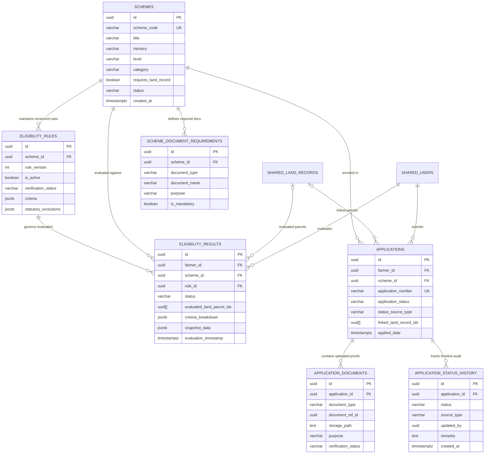

# PostgreSQL Database Design (Supabase): Government Schemes and Eligibility Module

> **Document Type**: Technical Specification and Relational Database Schema Design (Supabase / PostgreSQL)  
> **Module**: Government Schemes and Eligibility Module (`KisanSarthi`)  
> **Target Database**: Shared KisanSarthi Supabase Instance (PostgreSQL 15+)  
> **Audited Policy References**: [`MODULE_PLAN.md`](file:///c:/Users/angha/Projects/KisanSarthi/MODULE_PLAN.md), [`PM_KISAN_RESEARCH.md`](file:///c:/Users/angha/Projects/KisanSarthi/PM_KISAN_RESEARCH.md), and [`PM_KISAN_VERIFICATION.md`](file:///c:/Users/angha/Projects/KisanSarthi/PM_KISAN_VERIFICATION.md)  
> **Revision Date**: November 3, 2026  
> **Database Architecture**: Relational (PostgreSQL) with JSONB for declarative criteria and snapshots  

---

## CHANGELOG: Migration from MongoDB to Supabase (PostgreSQL)

| Version | Date | Author | Summary of Changes |
|---|---|---|---|
| **v1.0.0** | Nov 3, 2026 (13:51) | Angha Singh | Initial NoSQL document design using MongoDB collections (`schemes`, `eligibilityRules`, `eligibilityResults`, `applications`). |
| **v1.1.0** | Nov 3, 2026 (14:07) | Angha Singh | Revised MongoDB schema: added PII protections, partial unique index, draft document exemptions, and status provenance. |
| **v2.0.0** | Nov 3, 2026 (23:45) | Angha Singh | **Full Architectural Migration to Supabase (PostgreSQL)**:<br>• Replaced MongoDB collection schemas with normalized PostgreSQL tables (`schemes`, `scheme_document_requirements`, `eligibility_rules`, `eligibility_results`, `applications`, `application_documents`, `application_status_history`).<br>• Converted all identifiers to `UUID` primary keys (`gen_random_uuid()`) and relational foreign keys (`REFERENCES`).<br>• Standardized on `snake_case` column names and native `timestamptz` timestamp types.<br>• Separated scheme document requirements from eligibility rules into a dedicated relational table (`scheme_document_requirements`).<br>• Enforced rule versioning via a PostgreSQL partial unique index (`WHERE is_active = true`).<br>• Formulated a proposed Row Level Security (RLS) policy matrix for review and approval by the backend team.<br>• Replaced Mongoose/NoSQL connection assumptions with Supabase client / PostgreSQL connection pooling conventions.<br>• Updated backend integration inquiries for Supabase Auth, Supabase Storage, and shared relational tables. |

---

## 1. Architectural Principles and Supabase Shared Database Policy

### 1.1 Shared PostgreSQL Instance via Supabase
* **Zero Duplicate Databases**: This module **does not** create a separate database cluster or isolated database instance. It operates directly within the shared KisanSarthi Supabase PostgreSQL project.
* **Unified Client / Pool Access**: The module interacts with the database using the shared Supabase client (`@supabase/supabase-js`) or the central PostgreSQL connection pool (`pg` / Prisma / Kysely as decided by the platform team). No secondary connections or uncoordinated connection pools are created.
* **Relational Normalization with Structured JSONB**: 
  - Relational tables and explicit foreign keys (`UUID`) are used for entities with relational lifecycles (`schemes`, `scheme_document_requirements`, `eligibility_rules`, `eligibility_results`, `applications`, `application_documents`, `application_status_history`).
  - Native `jsonb` is utilized selectively for flexible, declarative eligibility rule criteria and frozen criteria evaluation breakdowns, avoiding brittle column proliferation while retaining indexing capabilities (`GIN`).

### 1.2 Zero Data Duplication
* Farmer profile attributes (name, social category, date of birth, domicile) and land parcel attributes (survey number, acreage, cultivable status, mutation date) are **not duplicated** inside the schemes module tables.
* The module stores only relational foreign keys (`uuid`) referencing the shared `auth.users` / `public.users` (or `public.farmers`) and `public.land_records` tables.

### 1.3 Strict Separation of Concerns
1. **Statutory Eligibility Rules**: Legal prerequisites defined by government gazettes and guidelines (e.g., cultivable land ownership, cut-off dates, statutory exclusions). Handled in `eligibility_rules`.
2. **Registration / Deduplication Inputs**: Identification and administrative fields needed during portal enrollment (e.g., mobile number, ration card). Handled during application drafting.
3. **Document Requirements**: Mandatory and optional proofs needed for submission (e.g., Record of Rights, bank passbook). Separated into `scheme_document_requirements`.
4. **Payment / Disbursement Prerequisites**: Aadhaar-NPCI bridge seeding and bank validity checks. Handled as evaluation prerequisites, not conflated with land title rules.

### 1.4 Rule Immutability & Historical Audit Reproducibility
* When a government scheme amends its eligibility criteria, active rule rows in `eligibility_rules` are **never updated in place**.
* A new row is inserted with an incremented `rule_version` and set to `is_active = true`, while the superseded rule is marked `is_active = false`.
* Every evaluation in `eligibility_results` references the exact `rule_id` (`UUID`) evaluated, ensuring historic decisions can be reproduced years later.

### 1.5 Strict PII Protection in Snapshots
* Evaluation audit records (`eligibility_results.snapshot_data`) must preserve non-sensitive parameters evaluated (total hectares, parcel count, state code, social category, self-declaration flags).
* **Strict Privacy Rule**: Full 12-digit Aadhaar numbers, bank account numbers, IFSC codes, and PAN details are **strictly barred** from `snapshot_data`. Only boolean flags (e.g., `is_aadhaar_verified`, `is_bank_aadhaar_seeded`) are captured.

### 1.6 Status Provenance & Integrity
* Application status transitions in `applications` maintain an explicit `status_source_type` (`farmer_reported`, `admin_updated`, `api_verified`).
* Self-reported farmer submissions are tracked under `farmer_reported`. Terminal or officially verified statuses (`approved`, `rejected`, `disbursed`) are guarded by constraints to prevent unverified farmer inputs from masquerading as verified outcomes.

---

## 2. Entity-Relationship (ER) Overview



---

## 3. Relational Table Specifications

---

### Table 1: `schemes`

#### 1. Purpose
Master catalogue for all Central and State Government agricultural welfare schemes, subsidies, and credit facilities. Stores high-level metadata, funding levels, benefits, application windows, and operational statuses.

#### 2. DDL Schema Definition
```sql
CREATE TABLE schemes (
    id UUID PRIMARY KEY DEFAULT gen_random_uuid(),
    scheme_code VARCHAR(50) NOT NULL,
    title VARCHAR(255) NOT NULL,
    short_description VARCHAR(500) NOT NULL,
    detailed_description TEXT NOT NULL,
    ministry VARCHAR(255) NOT NULL,
    department VARCHAR(255),
    level VARCHAR(20) NOT NULL CHECK (level IN ('central', 'state')),
    applicable_states TEXT[] NOT NULL DEFAULT '{"ALL"}',
    category VARCHAR(50) NOT NULL CHECK (category IN (
        'direct_benefit_transfer',
        'crop_insurance',
        'credit_subvention',
        'irrigation_subsidy',
        'machinery_subsidy',
        'soil_health',
        'other'
    )),
    requires_land_record BOOLEAN NOT NULL DEFAULT true,
    benefit_type VARCHAR(50) NOT NULL CHECK (benefit_type IN (
        'financial_transfer',
        'interest_subvention',
        'premium_subsidy',
        'equipment_subsidy',
        'input_grant'
    )),
    benefit_annual_amount NUMERIC(12, 2),
    benefit_disbursement_schedule VARCHAR(255),
    benefit_summary TEXT NOT NULL,
    official_url TEXT NOT NULL,
    guidelines_doc_url TEXT,
    is_always_open BOOLEAN NOT NULL DEFAULT true,
    application_start_date TIMESTAMPTZ,
    application_end_date TIMESTAMPTZ,
    status VARCHAR(20) NOT NULL DEFAULT 'active' CHECK (status IN ('active', 'upcoming', 'closed', 'archived')),
    version INTEGER NOT NULL DEFAULT 1,
    created_at TIMESTAMPTZ NOT NULL DEFAULT now(),
    updated_at TIMESTAMPTZ NOT NULL DEFAULT now()
);

-- Unique business code
CREATE UNIQUE INDEX idx_schemes_scheme_code ON schemes (UPPER(scheme_code));

-- Composite query index for catalog browsing and filtering
CREATE INDEX idx_schemes_catalog_search ON schemes (status, level, category);
```

#### 3. Field Dictionary

| Column Name | PostgreSQL Data Type | Constraints | Description / Business Meaning |
|---|---|---|---|
| `id` | `UUID` | `PRIMARY KEY`, default `gen_random_uuid()` | Unique surrogate identifier. |
| `scheme_code` | `VARCHAR(50)` | `NOT NULL`, `UNIQUE` (case-insensitive) | Business code (e.g., `'PM-KISAN'`, `'PMFBY'`). |
| `title` | `VARCHAR(255)` | `NOT NULL` | Official name of the scheme. |
| `short_description` | `VARCHAR(500)` | `NOT NULL` | Concise abstract for search cards. |
| `detailed_description`| `TEXT` | `NOT NULL` | Full narrative covering objectives and legal provisions. |
| `ministry` | `VARCHAR(255)` | `NOT NULL` | Sponsoring Ministry (e.g., `'Ministry of Agriculture & Farmers Welfare'`). |
| `department` | `VARCHAR(255)` | Optional | Department (e.g., `'DA&FW'`). |
| `level` | `VARCHAR(20)` | `NOT NULL`, `CHECK` (`central`, `state`) | Administrative tier. |
| `applicable_states` | `TEXT[]` | `NOT NULL`, default `'{"ALL"}'` | Array of ISO state codes (e.g., `{"MH", "UP"}`) or `{"ALL"}`. |
| `category` | `VARCHAR(50)` | `NOT NULL`, `CHECK` | Welfare category. |
| `requires_land_record`| `BOOLEAN` | `NOT NULL`, default `true` | `true` if scheme mandates certified land title; `false` for non-land subsidies. |
| `benefit_type` | `VARCHAR(50)` | `NOT NULL`, `CHECK` | Type of assistance. |
| `benefit_annual_amount`| `NUMERIC(12, 2)`| Optional | Monetary payout per annum (e.g., `6000.00`). |
| `benefit_disbursement_schedule`| `VARCHAR(255)`| Optional | E.g., `'Three equal installments of Rs. 2,000 every 4 months'`. |
| `benefit_summary` | `TEXT` | `NOT NULL` | Plain-language benefit summary. |
| `official_url` | `TEXT` | `NOT NULL` | Direct URL to government portal. |
| `guidelines_doc_url`| `TEXT` | Optional | Direct link to official guidelines PDF. |
| `is_always_open` | `BOOLEAN` | `NOT NULL`, default `true` | `true` for continuous schemes; `false` for seasonal cut-offs. |
| `application_start_date`| `TIMESTAMPTZ` | Optional | Open date of current application window. |
| `application_end_date`| `TIMESTAMPTZ` | Optional | Deadline of application window. |
| `status` | `VARCHAR(20)` | `NOT NULL`, `CHECK` | Operational status (`active`, `upcoming`, `closed`, `archived`). |
| `version` | `INTEGER` | `NOT NULL`, default `1` | Schema version counter. |
| `created_at` | `TIMESTAMPTZ` | `NOT NULL`, default `now()` | Timestamp of creation. |
| `updated_at` | `TIMESTAMPTZ` | `NOT NULL`, default `now()` | Timestamp of last modification. |

---

### Table 2: `scheme_document_requirements`

#### 1. Purpose
Maintains the list of physical or digital proofs required to submit a verified application for a scheme. Keeping this table relational and separate from `eligibility_rules` ensures that documentation requirements can be modified without altering statutory criteria.

#### 2. DDL Schema Definition
```sql
CREATE TABLE scheme_document_requirements (
    id UUID PRIMARY KEY DEFAULT gen_random_uuid(),
    scheme_id UUID NOT NULL REFERENCES schemes(id) ON DELETE CASCADE,
    document_type VARCHAR(50) NOT NULL CHECK (document_type IN (
        'aadhaar_card',
        'land_ownership_proof',
        'bank_passbook',
        'ration_card',
        'caste_certificate',
        'sowing_certificate',
        'tenant_lease_agreement',
        'other'
    )),
    document_name VARCHAR(255) NOT NULL,
    purpose VARCHAR(100) NOT NULL,
    is_mandatory BOOLEAN NOT NULL DEFAULT true,
    description TEXT,
    max_size_kb INTEGER NOT NULL DEFAULT 2048,
    created_at TIMESTAMPTZ NOT NULL DEFAULT now(),
    updated_at TIMESTAMPTZ NOT NULL DEFAULT now()
);

CREATE INDEX idx_scheme_docs_scheme_id ON scheme_document_requirements (scheme_id);
```

#### 3. Field Dictionary

| Column Name | PostgreSQL Data Type | Constraints | Description / Business Meaning |
|---|---|---|---|
| `id` | `UUID` | `PRIMARY KEY`, default `gen_random_uuid()` | Unique record ID. |
| `scheme_id` | `UUID` | `NOT NULL`, `REFERENCES schemes(id)` | Foreign key to parent scheme. Cascades on delete. |
| `document_type` | `VARCHAR(50)` | `NOT NULL`, `CHECK` | System document category code. |
| `document_name` | `VARCHAR(255)` | `NOT NULL` | Display title (e.g., `'Record of Rights / 7/12 Extract'`). |
| `purpose` | `VARCHAR(100)` | `NOT NULL` | Specific administrative purpose (e.g., `'land_ownership_and_cultivable_status'`). |
| `is_mandatory` | `BOOLEAN` | `NOT NULL`, default `true` | `true` if mandatory for final submission; `false` if optional/fallback. |
| `description` | `TEXT` | Optional | Instructions (e.g., `'Certified PDF extract under 200 KB'`). |
| `max_size_kb` | `INTEGER` | `NOT NULL`, default `2048` | Max allowed file size in kilobytes. |
| `created_at` | `TIMESTAMPTZ` | `NOT NULL`, default `now()` | Timestamp of creation. |
| `updated_at` | `TIMESTAMPTZ` | `NOT NULL`, default `now()` | Timestamp of last update. |

---

### Table 3: `eligibility_rules`

#### 1. Purpose
Stores modular, declarative, versioned evaluation criteria and statutory exclusions. Rules are **immutable once activated**. A PostgreSQL partial unique index guarantees that at most one rule set is active per scheme.

#### 2. DDL Schema Definition
```sql
CREATE TABLE eligibility_rules (
    id UUID PRIMARY KEY DEFAULT gen_random_uuid(),
    scheme_id UUID NOT NULL REFERENCES schemes(id) ON DELETE CASCADE,
    rule_version INTEGER NOT NULL DEFAULT 1,
    is_active BOOLEAN NOT NULL DEFAULT true,
    official_source_url TEXT NOT NULL,
    source_document_name VARCHAR(255) NOT NULL,
    source_section VARCHAR(255) NOT NULL,
    verification_status VARCHAR(30) NOT NULL DEFAULT 'needs_further_verification' 
        CHECK (verification_status IN ('verified', 'needs_further_verification')),
    last_verified_date TIMESTAMPTZ NOT NULL,
    verified_by VARCHAR(100) NOT NULL,
    criteria JSONB NOT NULL,
    statutory_exclusions JSONB NOT NULL DEFAULT '[]'::jsonb,
    created_at TIMESTAMPTZ NOT NULL DEFAULT now(),
    updated_at TIMESTAMPTZ NOT NULL DEFAULT now(),
    CONSTRAINT uq_scheme_rule_version UNIQUE (scheme_id, rule_version)
);

-- Partial Unique Index: Guarantees EXACTLY ONE active ruleset per scheme
CREATE UNIQUE INDEX idx_eligibility_rules_single_active 
    ON eligibility_rules (scheme_id) 
    WHERE is_active = true;

-- GIN index for deep querying of criteria JSONB
CREATE INDEX idx_eligibility_rules_criteria_gin 
    ON eligibility_rules USING GIN (criteria);
```

#### 3. Field Dictionary

| Column Name | PostgreSQL Data Type | Constraints | Description / Business Meaning |
|---|---|---|---|
| `id` | `UUID` | `PRIMARY KEY`, default `gen_random_uuid()` | Unique rule version identifier. |
| `scheme_id` | `UUID` | `NOT NULL`, `REFERENCES schemes(id)` | Foreign key to parent scheme. |
| `rule_version` | `INTEGER` | `NOT NULL`, default `1` | Sequential version integer. |
| `is_active` | `BOOLEAN` | `NOT NULL`, default `true` | Active status flag. Governed by partial unique index. |
| `official_source_url`| `TEXT` | `NOT NULL` | Authoritative government source link. |
| `source_document_name`| `VARCHAR(255)`| `NOT NULL` | Government publication name (e.g., `'Revised PM-KISAN Operational Guidelines'`). |
| `source_section` | `VARCHAR(255)` | `NOT NULL` | Specific section citations (e.g., `'Section 1.1, 1.2, 2.2, 4.1'`). |
| `verification_status`| `VARCHAR(30)` | `NOT NULL`, `CHECK` | `'verified'` if legally confirmed; `'needs_further_verification'` otherwise. |
| `last_verified_date`| `TIMESTAMPTZ` | `NOT NULL` | Timestamp when rules were confirmed against gazettes. |
| `verified_by` | `VARCHAR(100)` | `NOT NULL` | Auditor or role identifier. |
| `criteria` | `JSONB` | `NOT NULL` | Parameterized evaluation parameters (farmer family, landholding, geography). |
| `statutory_exclusions`| `JSONB` | `NOT NULL`, default `'[]'::jsonb`| Array of exclusion definitions, contagion flags, thresholds, and citations. |
| `created_at` | `TIMESTAMPTZ` | `NOT NULL`, default `now()` | Timestamp of creation. |
| `updated_at` | `TIMESTAMPTZ` | `NOT NULL`, default `now()` | Timestamp of last update. |

#### 4. Parameterized Structure of `criteria` (JSONB)
```json
{
  "farmer_family": {
    "requires_family_unit": true,
    "allow_multiple_claims_per_family": false,
    "minor_to_major_cutoff_date": "2019-02-01T00:00:00Z"
  },
  "landholding": {
    "requires_cultivable_land": true,
    "min_hectares": null,
    "max_hectares": null,
    "cutoff_date": "2019-02-01T00:00:00Z",
    "allowed_post_cutoff_transfer_types": ["succession_death"],
    "disallowed_post_cutoff_transfer_types": ["purchase", "gift", "voluntary_partition"],
    "required_title_type": "owner"
  },
  "geography": {
    "allowed_states": ["ALL"],
    "excluded_states": []
  },
  "demographics": {
    "social_categories": ["ALL"]
  }
}
```

---

### Table 4: `eligibility_results`

#### 1. Purpose
Historical and audit trail of eligibility assessments conducted for authenticated farmers. Preserves criteria breakdown, gap analysis, pending verification guidance, and frozen non-sensitive evaluation parameters.

#### 2. DDL Schema Definition
```sql
CREATE TABLE eligibility_results (
    id UUID PRIMARY KEY DEFAULT gen_random_uuid(),
    farmer_id UUID NOT NULL, -- FK to shared user/farmer table (to confirm with backend team)
    scheme_id UUID NOT NULL REFERENCES schemes(id) ON DELETE CASCADE,
    rule_id UUID NOT NULL REFERENCES eligibility_rules(id) ON DELETE RESTRICT,
    status VARCHAR(25) NOT NULL CHECK (status IN ('eligible', 'not_eligible', 'needs_verification')),
    evaluation_timestamp TIMESTAMPTZ NOT NULL DEFAULT now(),
    summary TEXT NOT NULL,
    evaluated_land_parcel_ids UUID[] DEFAULT '{}',
    criteria_breakdown JSONB NOT NULL,
    disqualification_reasons TEXT[] DEFAULT '{}',
    pending_verification_items JSONB DEFAULT '[]'::jsonb,
    snapshot_data JSONB NOT NULL,
    created_at TIMESTAMPTZ NOT NULL DEFAULT now(),
    updated_at TIMESTAMPTZ NOT NULL DEFAULT now()
);

-- Fast lookup for farmer eligibility history
CREATE INDEX idx_eligibility_results_farmer_lookup 
    ON eligibility_results (farmer_id, scheme_id, evaluation_timestamp DESC);

-- Index for filtering by evaluation status
CREATE INDEX idx_eligibility_results_status 
    ON eligibility_results (farmer_id, status);
```

#### 3. Field Dictionary

| Column Name | PostgreSQL Data Type | Constraints | Description / Business Meaning |
|---|---|---|---|
| `id` | `UUID` | `PRIMARY KEY`, default `gen_random_uuid()` | Unique evaluation record ID. |
| `farmer_id` | `UUID` | `NOT NULL` | Foreign key referencing the authenticated farmer in the shared auth/users table. |
| `scheme_id` | `UUID` | `NOT NULL`, `REFERENCES schemes(id)` | Evaluated scheme. |
| `rule_id` | `UUID` | `NOT NULL`, `REFERENCES eligibility_rules(id)` | Exact version of the rule evaluated (`ON DELETE RESTRICT` protects auditability). |
| `status` | `VARCHAR(25)` | `NOT NULL`, `CHECK` | Outcome (`'eligible'`, `'not_eligible'`, `'needs_verification'`). |
| `evaluation_timestamp`| `TIMESTAMPTZ` | `NOT NULL`, default `now()` | Exact time when evaluation was executed. |
| `summary` | `TEXT` | `NOT NULL` | Farmer-facing plain-language summary of the result. |
| `evaluated_land_parcel_ids`| `UUID[]` | Default `'{}'` | Array of land parcel UUIDs evaluated (supports multiple parcels). |
| `criteria_breakdown` | `JSONB` | `NOT NULL` | Granular array of evaluated criteria (`passed`, `failed`, `verification_required`). |
| `disqualification_reasons`| `TEXT[]` | Default `'{}'` | List of confirmed statutory failure reasons (if `not_eligible`). |
| `pending_verification_items`| `JSONB` | Default `'[]'::jsonb` | Actionable items if `needs_verification` (item code, target module, target record). |
| `snapshot_data` | `JSONB` | `NOT NULL` | **Frozen non-sensitive evaluation snapshot** (state, total hectares, parcel count, boolean verification flags). Full Aadhaar and bank details are strictly omitted. |
| `created_at` | `TIMESTAMPTZ` | `NOT NULL`, default `now()` | Creation timestamp. |
| `updated_at` | `TIMESTAMPTZ` | `NOT NULL`, default `now()` | Update timestamp. |

#### 4. Structure of `snapshot_data` (JSONB)
```json
{
  "evaluated_state": "MH",
  "social_category": "OBC",
  "total_cultivable_hectares": 2.35,
  "parcel_count": 2,
  "is_aadhaar_verified": true,
  "is_bank_aadhaar_seeded": true,
  "self_declared_exclusions_passed": true
}
```

---

### Table 5: `applications`

#### 1. Purpose
Tracks the application lifecycle for enrolled schemes. Supports multiple or zero land parcel references, draft initialization without documents, user-reported external tracking numbers, and status provenance tracking.

#### 2. DDL Schema Definition
```sql
CREATE TABLE applications (
    id UUID PRIMARY KEY DEFAULT gen_random_uuid(),
    farmer_id UUID NOT NULL, -- FK to shared user/farmer table
    scheme_id UUID NOT NULL REFERENCES schemes(id) ON DELETE CASCADE,
    application_number VARCHAR(50) NOT NULL,
    application_status VARCHAR(25) NOT NULL DEFAULT 'draft' CHECK (application_status IN (
        'draft',
        'ready_to_apply',
        'submitted_external',
        'under_verification',
        'approved',
        'rejected',
        'disbursed'
    )),
    linked_land_record_ids UUID[] DEFAULT '{}',
    status_source_type VARCHAR(25) NOT NULL DEFAULT 'farmer_reported' CHECK (status_source_type IN (
        'farmer_reported',
        'admin_updated',
        'api_verified'
    )),
    status_source_updated_by UUID NOT NULL,
    status_source_updated_at TIMESTAMPTZ NOT NULL DEFAULT now(),
    status_source_proof_ref TEXT,
    status_source_notes TEXT,
    external_portal_name VARCHAR(255),
    external_registration_number VARCHAR(100),
    external_official_check_url TEXT,
    external_farmer_reported_claim VARCHAR(50),
    external_reported_date TIMESTAMPTZ,
    applied_date TIMESTAMPTZ,
    farmer_notes TEXT,
    created_at TIMESTAMPTZ NOT NULL DEFAULT now(),
    updated_at TIMESTAMPTZ NOT NULL DEFAULT now(),
    -- Provenance Integrity: Official terminal statuses CANNOT be farmer-reported
    CONSTRAINT chk_status_provenance_integrity CHECK (
        application_status NOT IN ('approved', 'rejected', 'disbursed') 
        OR status_source_type IN ('admin_updated', 'api_verified')
    )
);

CREATE UNIQUE INDEX idx_applications_app_number ON applications (UPPER(application_number));
CREATE INDEX idx_applications_farmer_scheme ON applications (farmer_id, scheme_id);
CREATE INDEX idx_applications_provenance ON applications (application_status, status_source_type);
```

#### 3. Field Dictionary

| Column Name | PostgreSQL Data Type | Constraints | Description / Business Meaning |
|---|---|---|---|
| `id` | `UUID` | `PRIMARY KEY`, default `gen_random_uuid()` | Unique application record ID. |
| `farmer_id` | `UUID` | `NOT NULL` | Foreign key referencing the farmer in the shared auth/users table. |
| `scheme_id` | `UUID` | `NOT NULL`, `REFERENCES schemes(id)` | Scheme applied for. |
| `application_number`| `VARCHAR(50)` | `NOT NULL`, `UNIQUE` | Internal KisanSarthi tracking code (e.g., `'KS-APP-2026-00891'`). |
| `application_status`| `VARCHAR(25)` | `NOT NULL`, `CHECK` | State machine status (`'draft'`, `'ready_to_apply'`, `'submitted_external'`, etc.). |
| `linked_land_record_ids`| `UUID[]` | Default `'{}'` | Array of referenced land parcel UUIDs (empty for non-land schemes). |
| `status_source_type`| `VARCHAR(25)` | `NOT NULL`, `CHECK` | Origin of current status (`'farmer_reported'`, `'admin_updated'`, `'api_verified'`). |
| `status_source_updated_by`| `UUID` | `NOT NULL` | User/Admin ID who committed the status transition. |
| `status_source_updated_at`| `TIMESTAMPTZ` | `NOT NULL`, default `now()` | Timestamp of the status transition. |
| `status_source_proof_ref`| `TEXT` | Optional | E.g., official receipt number or physical order reference. |
| `status_source_notes`| `TEXT` | Optional | Contextual notes regarding the status source. |
| `external_portal_name`| `VARCHAR(255)`| Optional | E.g., `'PM-KISAN National Portal'`. |
| `external_registration_number`| `VARCHAR(100)`| Optional | Registration code or CSC receipt reference entered by farmer. |
| `external_official_check_url`| `TEXT` | Optional | Direct link to official government portal tracking tool. |
| `external_farmer_reported_claim`| `VARCHAR(50)`| Optional | Self-reported claim (e.g., `'claimed_submitted'`). |
| `external_reported_date`| `TIMESTAMPTZ`| Optional | Date when farmer reported the external code. |
| `applied_date` | `TIMESTAMPTZ` | Optional | Official submission date. |
| `farmer_notes` | `TEXT` | Optional | Farmer's personal application notes. |
| `created_at` | `TIMESTAMPTZ` | `NOT NULL`, default `now()` | Creation timestamp. |
| `updated_at` | `TIMESTAMPTZ` | `NOT NULL`, default `now()` | Update timestamp. |

---

### Table 6: `application_documents`

#### 1. Purpose
Maintains supporting proofs attached to a specific application. Integrates with Supabase Storage buckets or references shared platform document records.

#### 2. DDL Schema Definition
```sql
CREATE TABLE application_documents (
    id UUID PRIMARY KEY DEFAULT gen_random_uuid(),
    application_id UUID NOT NULL REFERENCES applications(id) ON DELETE CASCADE,
    document_type VARCHAR(50) NOT NULL,
    document_ref_id UUID, -- Optional FK to shared documents repository
    storage_path TEXT,    -- Supabase Storage object path (e.g., 'applications/doc_123.pdf')
    purpose VARCHAR(100) NOT NULL,
    file_name VARCHAR(255) NOT NULL,
    file_size_kb INTEGER,
    mime_type VARCHAR(100),
    verification_status VARCHAR(20) NOT NULL DEFAULT 'pending' 
        CHECK (verification_status IN ('pending', 'verified', 'rejected')),
    created_at TIMESTAMPTZ NOT NULL DEFAULT now(),
    updated_at TIMESTAMPTZ NOT NULL DEFAULT now()
);

CREATE INDEX idx_app_docs_application_id ON application_documents (application_id);
```

#### 3. Field Dictionary

| Column Name | PostgreSQL Data Type | Constraints | Description / Business Meaning |
|---|---|---|---|
| `id` | `UUID` | `PRIMARY KEY`, default `gen_random_uuid()` | Unique record ID. |
| `application_id` | `UUID` | `NOT NULL`, `REFERENCES applications(id)` | Parent application. Cascades on delete. |
| `document_type` | `VARCHAR(50)` | `NOT NULL` | Document category (e.g., `'land_ownership_proof'`). |
| `document_ref_id`| `UUID` | Optional | Reference to shared documents table if platform maintains one. |
| `storage_path` | `TEXT` | Optional | Storage path within Supabase Storage bucket. |
| `purpose` | `VARCHAR(100)` | `NOT NULL` | Purpose mapping from `scheme_document_requirements`. |
| `file_name` | `VARCHAR(255)` | `NOT NULL` | Original uploaded filename. |
| `file_size_kb` | `INTEGER` | Optional | File size in kilobytes. |
| `mime_type` | `VARCHAR(100)` | Optional | E.g., `'application/pdf'`. |
| `verification_status`| `VARCHAR(20)` | `NOT NULL`, default `'pending'` | Document audit status (`pending`, `verified`, `rejected`). |
| `created_at` | `TIMESTAMPTZ` | `NOT NULL`, default `now()` | Creation timestamp. |
| `updated_at` | `TIMESTAMPTZ` | `NOT NULL`, default `now()` | Update timestamp. |

---

### Table 7: `application_status_history`

#### 1. Purpose
Maintains an immutable chronological audit trail of all state transitions and remarks for each application.

#### 2. DDL Schema Definition
```sql
CREATE TABLE application_status_history (
    id UUID PRIMARY KEY DEFAULT gen_random_uuid(),
    application_id UUID NOT NULL REFERENCES applications(id) ON DELETE CASCADE,
    status VARCHAR(25) NOT NULL,
    source_type VARCHAR(25) NOT NULL CHECK (source_type IN ('farmer_reported', 'admin_updated', 'api_verified')),
    updated_by UUID NOT NULL,
    remarks TEXT,
    created_at TIMESTAMPTZ NOT NULL DEFAULT now()
);

CREATE INDEX idx_app_status_history_app_id 
    ON application_status_history (application_id, created_at ASC);
```

---

## 4. Proposed Row Level Security (RLS) Strategy

> [!IMPORTANT]
> **Status: PROPOSED FOR REVIEW AND APPROVAL BY THE BACKEND TEAM**  
> Row Level Security (RLS) policies must be coordinated with the platform's central authentication architecture (Supabase Auth `auth.users`, JWT metadata, or custom user role tables). The policies below are proposed specifications designed to secure the Government Schemes and Eligibility module.

### 4.1 RLS Activation
```sql
-- Enable RLS on all module tables
ALTER TABLE schemes ENABLE ROW LEVEL SECURITY;
ALTER TABLE scheme_document_requirements ENABLE ROW LEVEL SECURITY;
ALTER TABLE eligibility_rules ENABLE ROW LEVEL SECURITY;
ALTER TABLE eligibility_results ENABLE ROW LEVEL SECURITY;
ALTER TABLE applications ENABLE ROW LEVEL SECURITY;
ALTER TABLE application_documents ENABLE ROW LEVEL SECURITY;
ALTER TABLE application_status_history ENABLE ROW LEVEL SECURITY;
```

### 4.2 Proposed Policies by Table

#### 1. `schemes` & `scheme_document_requirements`
* **Read (SELECT)**: Public / Anonymous and Authenticated users can read active and upcoming schemes.
  ```sql
  CREATE POLICY "Public schemes viewable by everyone" 
  ON schemes FOR SELECT 
  USING (status IN ('active', 'upcoming'));

  CREATE POLICY "Public document requirements viewable by everyone" 
  ON scheme_document_requirements FOR SELECT 
  USING (true);
  ```
* **Write (INSERT, UPDATE, DELETE)**: Restricted strictly to platform administrators (`auth.jwt() ->> 'role' = 'admin'`).

#### 2. `eligibility_rules`
* **Read (SELECT)**: Authenticated users can read active rule definitions for evaluation transparency.
  ```sql
  CREATE POLICY "Active rules viewable by authenticated users" 
  ON eligibility_rules FOR SELECT 
  TO authenticated 
  USING (is_active = true);
  ```
* **Write (INSERT, UPDATE, DELETE)**: Restricted to administrative personnel.

#### 3. `eligibility_results`
* **Farmer Isolation (SELECT)**: Farmers can view **only their own** evaluation records.
  ```sql
  CREATE POLICY "Farmers view own eligibility results" 
  ON eligibility_results FOR SELECT 
  TO authenticated 
  USING (auth.uid() = farmer_id);
  ```
* **Farmer Execution (INSERT)**: Farmers can insert evaluations where `farmer_id` matches their authenticated UID.
  ```sql
  CREATE POLICY "Farmers insert own eligibility evaluations" 
  ON eligibility_results FOR INSERT 
  TO authenticated 
  WITH CHECK (auth.uid() = farmer_id);
  ```
* **Administrative Audit**: System administrators and agriculture verification officers have read access across all results for audit reporting.

#### 4. `applications` & Child Tables
* **Farmer Isolation (SELECT)**: Farmers can view only their own applications and status history.
  ```sql
  CREATE POLICY "Farmers view own applications" 
  ON applications FOR SELECT 
  TO authenticated 
  USING (auth.uid() = farmer_id);

  CREATE POLICY "Farmers view own application documents" 
  ON application_documents FOR SELECT 
  TO authenticated 
  USING (EXISTS (
      SELECT 1 FROM applications 
      WHERE applications.id = application_documents.application_id 
      AND applications.farmer_id = auth.uid()
  ));
  ```
* **Farmer Modification (UPDATE)**: Farmers can update only their own applications in `'draft'` state or update external reference numbers.
  ```sql
  CREATE POLICY "Farmers update own draft applications" 
  ON applications FOR UPDATE 
  TO authenticated 
  USING (auth.uid() = farmer_id AND application_status = 'draft')
  WITH CHECK (auth.uid() = farmer_id);
  ```
* **Official Status Updates**: Updating application statuses to terminal stages (`approved`, `rejected`, `disbursed`) is restricted to authorized agriculture officers and admins.

---

## 5. Integration Requirements with KisanSarthi Platform

### 5.1 Connection with Authentication & Farmer Profiles
* **Foreign Key Reference**: `farmer_id UUID REFERENCES auth.users(id)` (or `public.users(id)`).
* **Coupling Mechanism**: Read-only query to retrieve demographic information (domicile state, district, social category) during eligibility evaluation.
* **Integrity Guard**: If profile information is missing, the engine evaluates to `needs_verification` targeting the farmer profile module, never defaulting to `not_eligible`.

### 5.2 Connection with Land Records Module
* **Foreign Key Reference**: `evaluated_land_parcel_ids UUID[]` and `linked_land_record_ids UUID[]`.
* **Optionality**: Only engaged if `schemes.requires_land_record = true`. For non-land schemes, this evaluation step is bypassed.
* **Attributes Queried (Read-Only)**:
  - `verification_status`: Must be certified (`'verified'`). Unverified parcels trigger `needs_verification`.
  - `cultivable_area_hectares`: Pooled across multiple parcels.
  - `mutation_date`: Evaluated against cut-off date (`2019-02-01` for PM-KISAN).
  - `mutation_type`: Validated against allowed post-cut-off transfer types (`'succession_death'`).
  - `ownership_type`: Must match scheme requirements (`'owner'` for PM-KISAN).

### 5.3 Connection with Document Storage (Supabase Storage)
* When farmers upload supporting documents, files will be stored in a dedicated Supabase Storage bucket (e.g., `application-documents`).
* `application_documents.storage_path` stores the relative storage object path, enabling secure signed URL generation via Supabase Storage APIs.

---

## 6. Technical Dependencies to Confirm with the Shared Backend Team

To ensure seamless integration with the larger KisanSarthi project, the following technical specifications must be confirmed with the backend engineering team before implementing database migrations:

| # | Inquiry Area | Required Information from Backend Teammates | Status | Why It Is Needed |
|---|---|---|---|---|
| 1 | **Shared User / Farmer Table** | Does the platform use Supabase's native `auth.users` directly for farmer IDs, or is there a synchronized `public.users` or `public.farmers` table? What is the exact primary key type (`UUID`) and column name? | **Pending Team Confirmation** | To configure the foreign key reference constraint on `farmer_id` across `eligibility_results` and `applications`. |
| 2 | **Shared Land Records Table** | What is the exact table name and schema for land records (e.g., `public.land_records` vs. `public.parcels`)? What is its primary key type (`UUID` vs. `BIGINT`)? | **Pending Team Confirmation** | To ensure array typing (`UUID[]`) in `evaluated_land_parcel_ids` and `linked_land_record_ids` matches the land module. |
| 3 | **Standard Land Area Unit** | What is the standard measurement unit used in the land records table (hectares vs. acres vs. regional gunthas/bighas)? Is there a standardized normalization utility? | **Pending Team Confirmation** | The eligibility engine compares total landholding against statutory thresholds and requires standardized acreage values. |
| 4 | **Land Verification Flag** | What exact column name and enum values denote official government verification in the land table (e.g., `verification_status = 'verified'` vs `is_verified = true`)? | **Pending Team Confirmation** | The eligibility engine relies on this field to distinguish between `eligible` and `needs_verification`. |
| 5 | **Role-Based Access Control (RBAC)** | How are user roles (e.g., `farmer`, `verifier`, `admin`) managed in Supabase? Are they stored in `auth.users.raw_app_meta_data`, custom JWT claims, or a separate `public.user_roles` table? | **Pending Team Confirmation** | Required to implement and test accurate Row Level Security (RLS) policies and Express authorization middleware. |
| 6 | **Supabase Storage Strategy** | What are the names and access rules of Supabase Storage buckets for farmer document uploads? Are bucket paths centralized or domain-separated? | **Pending Team Confirmation** | To properly configure file storage paths in `application_documents.storage_path`. |
| 7 | **Database Migration Workflow** | Which migration tooling does the team prefer for Supabase: Supabase CLI SQL migrations (`supabase/migrations/*.sql`), Prisma, Drizzle, or Knex? | **Pending Team Confirmation** | To deliver the finalized DDL in the team's chosen migration format without pipeline conflicts. |

---

## 7. Conclusion

This revised database design transitions the **Government Schemes and Eligibility Module** from an initial NoSQL document design to a high-integrity, relational Supabase (PostgreSQL) architecture. By establishing strong relational foreign keys, clean separation between document requirements and statutory rules, immutable rule versioning via partial unique indexes, status provenance tracking, and a proposed Row Level Security strategy, the data model ensures strict legal accuracy and engineering scalability for KisanSarthi.
