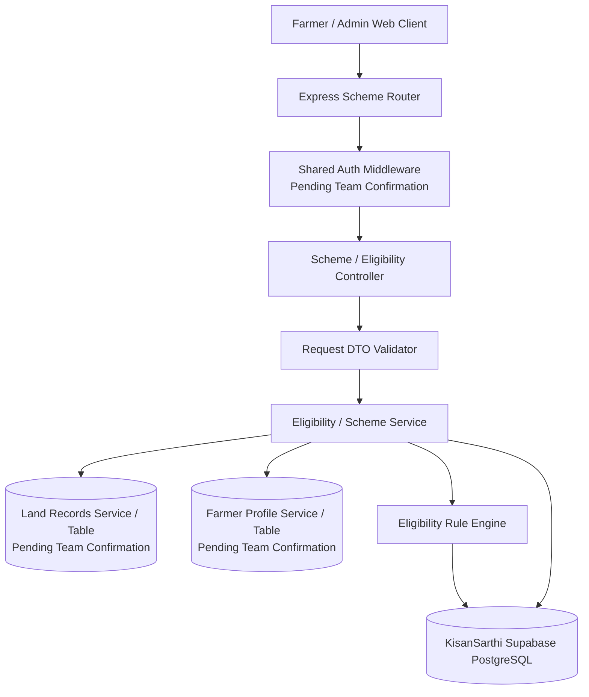
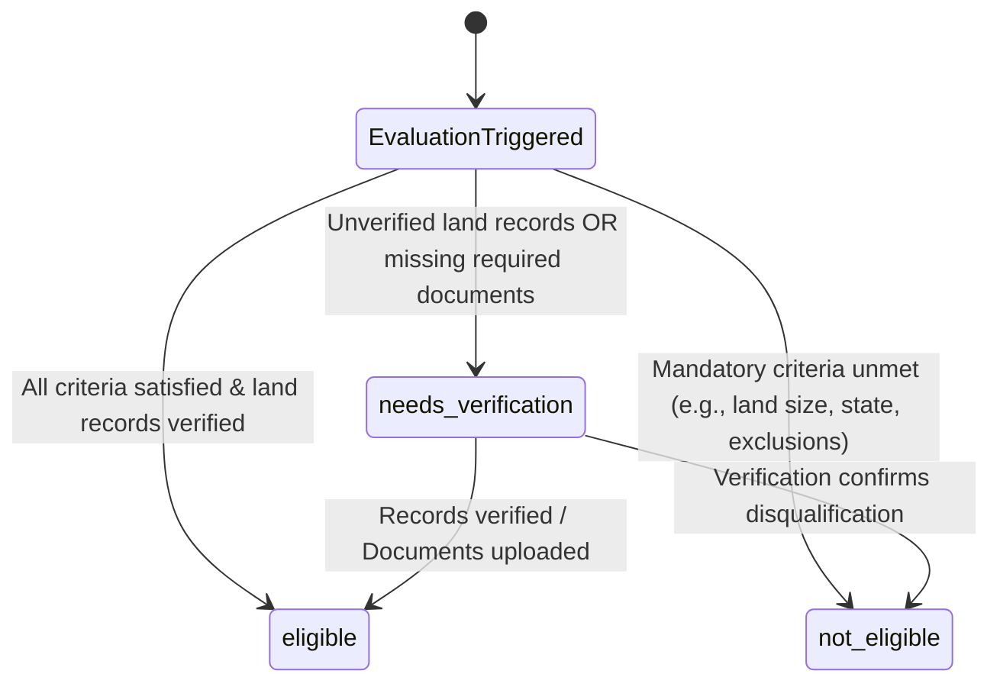

# Government Schemes and Eligibility Module - Architectural & Implementation Plan

> **Document Type**: Architecture Specification & Implementation Plan  
> **Module**: Government Schemes and Eligibility Module (`KisanSarthi`)  
> **Target Database Platform**: Supabase (PostgreSQL 15+)  
> **Backend Framework**: Node.js, Express  
> **Status**: Technical Planning & Specification (Sprint 1)  
> **Last Updated**: November 4, 2026  

---

## CHANGELOG: Migration from MongoDB to Supabase (PostgreSQL)

| Version | Date | Author | Summary of Changes |
|---|---|---|---|
| **v1.0.0** | Nov 3, 2026 (11:57) | Angha Singh | Initial architecture plan designed around MERN stack (Node.js, Express, MongoDB/Mongoose). |
| **v2.0.0** | Nov 3, 2026 (23:45) | Angha Singh | **Architectural Migration to Supabase (PostgreSQL)**:<br>• Replaced MongoDB NoSQL data models with normalized Supabase PostgreSQL relational schemas.<br>• Separated document requirements into dedicated relational schema (`scheme_document_requirements`).<br>• Updated indexing strategy to PostgreSQL B-tree, partial unique indexes, and GIN indexes for JSONB criteria.<br>• Preserved 100% of module functional requirements, 14 API endpoint contracts, and 3-state deterministic eligibility logic. |
| **v2.1.0** | Nov 4, 2026 (00:30) | Angha Singh | **Audit & Governance Refinement**:<br>• Removed lingering NoSQL/Mongoose implementation assumptions.<br>• Explicitly marked Supabase Auth, Storage buckets, Row Level Security (RLS), database client access library, and module integration conventions as **Pending Team Confirmation**.<br>• Added Section 8 detailing unconfirmed technical dependencies to prevent premature implementation assumptions. |

---

## 1. Module Overview and Objectives

### 1.1 Overview
The **Government Schemes and Eligibility Module** is a core functional pillar of the **KisanSarthi** platform. It connects small, marginal, and commercial farmers across India with relevant Central and State Government agricultural welfare schemes, subsidies, insurance programs, and credit facilities.

Rather than treating government schemes as static informational articles, this module integrates directly with KisanSarthi's **Farmer Profile** and **Land Records** modules to provide deterministic, dynamic eligibility assessments, actionable document checklists, and end-to-end application tracking.

### 1.2 Core Objectives
- **Mitigate Information Asymmetry**: Provide a searchable, categorized repository of active Central and State agricultural schemes.
- **Automated Eligibility Evaluation**: Cross-reference farmer profile data (social category, age, domicile) and certified land records (holding size, ownership title, mutation cut-off dates, crop types) against official statutory criteria without requiring manual calculation by the farmer.
- **Transparent Gap Analysis**: Clearly explain *why* a farmer is eligible, ineligible, or pending verification.
- **Streamlined Document Readiness**: Provide scheme-specific document requirements so farmers can prepare valid paperwork before applying.
- **Application Lifecycle Tracking**: Track internal and external reference numbers, application statuses, and timeline milestones.
- **Modular Full-Stack Integration**: Fit cleanly into the main KisanSarthi Express backend backed by Supabase (PostgreSQL) without spinning up separate services or duplicate database connections.

---

## 2. Features Breakdown

### 2.1 Government Scheme Catalogue
- **Dynamic Search & Filtering**: Multi-parameter search by keyword, sponsoring government (Central vs. State), state/UT, category (Direct Benefit Transfer, Crop Insurance, Irrigation Subsidy, Mechanization, Credit/Loan), and beneficiary type.
- **Status Lifecycle**: Support for `active`, `upcoming`, `closed`, and `archived` scheme states with validity start and end dates.
- **Pagination & Sorting**: Offset or cursor-based pagination with sorting by release date, deadline, or popularity.

### 2.2 Scheme Details
- **Comprehensive Metadata**: Scheme name, short summary, objectives, benefits structure (direct cash transfer, interest subvention, equipment subsidy percentage), sponsoring ministry/department, and implementing agency.
- **Official Portals & Guidelines**: Direct links to official government portals, downloadable official PDF guidelines, and helpline numbers.
- **Application Window**: Awareness of seasonal windows (e.g., Kharif/Rabi cut-off dates).

### 2.3 Farmer Eligibility Checker
- **Rule Evaluation Engine**: Evaluates official scheme criteria against authenticated farmer data.
- **Deterministic Rule Structure**: Evaluates criteria fields such as:
  - Landholding thresholds (cultivable ownership, zero upper ceiling for PM-KISAN, caps for small/marginal schemes).
  - Geographic jurisdiction (State, District, Agro-climatic zone).
  - Social / demographic category (General, OBC, SC, ST, Women farmers).
  - Statutory cut-off dates (e.g., land registered on or before 01.02.2019 or legal inheritance).
  - Explicit statutory exclusions (institutional landholders, constitutional post holders, income tax payees, civil servants).
- **Batch & Single Scheme Evaluation**: Farmers can assess eligibility for a single scheme or run a discovery scan across all active schemes.

### 2.4 Required Document Checklist
- **Dynamic Checklist Generation**: Identifies mandatory and optional documents needed per scheme (e.g., Aadhaar, Land Record / RoR / 7/12 extract, Bank Passbook, Sowing Certificate, Caste Certificate).
- **Readiness Verification**: Cross-checks which documents are already verified in KisanSarthi vs. documents the farmer must prepare or upload.

### 2.5 Eligibility Result Storage
- **Audit Trail & Snapshot**: Stores each evaluation result along with an immutable snapshot of non-sensitive evaluated parameters and timestamp.
- **Gap & Actionable Feedback**: Detailed explanation of missing requirements or statutory failure reasons.
- **Result Statuses**:
  - `eligible`: Verified match against all criteria.
  - `not_eligible`: Definite failure of one or more mandatory criteria.
  - `needs_verification`: Missing documents or unverified land records prevent a definitive ruling.

### 2.6 Application Tracking
- **Application Records**: Keeps track of farmer applications initiated or submitted through or referenced in KisanSarthi.
- **Tracking Identifiers**: Stores platform application ID and official government reference / acknowledgment numbers.
- **Status Progression**: Milestone tracking (`draft`, `ready_to_apply`, `submitted_external`, `under_verification`, `approved`, `rejected`, `disbursed`).
- **Status History & Provenance**: Audit log of date, status change, source type (`farmer_reported`, `admin_updated`, `api_verified`), and remarks from system or verification officers.

---

## 3. Proposed Supabase PostgreSQL Database Schemas

> [!IMPORTANT]
> **Status: PROPOSED DATABASE DESIGN AWAITING BACKEND TEAM CONFIRMATION**  
> The DDL schemas below represent technical specifications designed for the shared Supabase PostgreSQL instance. Tables, migrations, and Row Level Security policies have **not yet been executed in code**. Actual deployment is subject to joint review and alignment with the backend engineering team.

All proposed schemas utilize standard PostgreSQL data types, `UUID` primary keys (`gen_random_uuid()`), foreign key constraints, `timestamptz` timestamps, and `snake_case` naming conventions.

### 3.1 `schemes` Table
Master catalogue storing scheme metadata, benefit structures, and application timelines.

```sql
CREATE TABLE schemes (
    id UUID PRIMARY KEY DEFAULT gen_random_uuid(),
    scheme_code VARCHAR(50) UNIQUE NOT NULL,
    title VARCHAR(255) NOT NULL,
    short_description VARCHAR(500) NOT NULL,
    detailed_description TEXT NOT NULL,
    ministry VARCHAR(255) NOT NULL,
    department VARCHAR(255),
    level VARCHAR(20) NOT NULL CHECK (level IN ('central', 'state')),
    applicable_states TEXT[] NOT NULL DEFAULT '{"ALL"}',
    category VARCHAR(50) NOT NULL CHECK (category IN (
        'direct_benefit_transfer', 'crop_insurance', 'credit_subvention', 
        'irrigation_subsidy', 'machinery_subsidy', 'soil_health', 'other'
    )),
    requires_land_record BOOLEAN NOT NULL DEFAULT true,
    benefit_type VARCHAR(50) NOT NULL,
    benefit_annual_amount NUMERIC(12, 2),
    benefit_disbursement_schedule VARCHAR(255),
    benefit_summary TEXT NOT NULL,
    official_url TEXT NOT NULL,
    guidelines_doc_url TEXT,
    is_always_open BOOLEAN NOT NULL DEFAULT true,
    application_start_date TIMESTAMPTZ,
    application_end_date TIMESTAMPTZ,
    status VARCHAR(20) NOT NULL DEFAULT 'active' CHECK (status IN ('active', 'upcoming', 'closed', 'archived')),
    version INTEGER NOT NULL DEFAULT 1,
    created_at TIMESTAMPTZ NOT NULL DEFAULT now(),
    updated_at TIMESTAMPTZ NOT NULL DEFAULT now()
);
```

### 3.2 `scheme_document_requirements` Table
Separates document checklists from statutory eligibility rules, allowing document requirements to be configured independently.

```sql
CREATE TABLE scheme_document_requirements (
    id UUID PRIMARY KEY DEFAULT gen_random_uuid(),
    scheme_id UUID NOT NULL REFERENCES schemes(id) ON DELETE CASCADE,
    document_type VARCHAR(50) NOT NULL,
    document_name VARCHAR(255) NOT NULL,
    purpose VARCHAR(100) NOT NULL,
    is_mandatory BOOLEAN NOT NULL DEFAULT true,
    description TEXT,
    max_size_kb INTEGER NOT NULL DEFAULT 2048,
    created_at TIMESTAMPTZ NOT NULL DEFAULT now(),
    updated_at TIMESTAMPTZ NOT NULL DEFAULT now()
);
```

### 3.3 `eligibility_rules` Table
Maintains modular, declarative, versioned evaluation criteria and statutory exclusions. Rules are immutable once activated.

```sql
CREATE TABLE eligibility_rules (
    id UUID PRIMARY KEY DEFAULT gen_random_uuid(),
    scheme_id UUID NOT NULL REFERENCES schemes(id) ON DELETE CASCADE,
    rule_version INTEGER NOT NULL DEFAULT 1,
    is_active BOOLEAN NOT NULL DEFAULT true,
    official_source_url TEXT NOT NULL,
    source_document_name VARCHAR(255) NOT NULL,
    source_section VARCHAR(255) NOT NULL,
    verification_status VARCHAR(30) NOT NULL DEFAULT 'needs_further_verification' 
        CHECK (verification_status IN ('verified', 'needs_further_verification')),
    last_verified_date TIMESTAMPTZ NOT NULL,
    verified_by VARCHAR(100) NOT NULL,
    criteria JSONB NOT NULL,
    statutory_exclusions JSONB NOT NULL DEFAULT '[]'::jsonb,
    created_at TIMESTAMPTZ NOT NULL DEFAULT now(),
    updated_at TIMESTAMPTZ NOT NULL DEFAULT now(),
    CONSTRAINT uq_scheme_rule_version UNIQUE (scheme_id, rule_version)
);

-- Guarantees at most ONE active ruleset per scheme
CREATE UNIQUE INDEX idx_eligibility_rules_active 
    ON eligibility_rules (scheme_id) WHERE is_active = true;
```

### 3.4 `eligibility_results` Table
Preserves historical eligibility assessments for authenticated farmers, including criteria breakdowns and gap analysis.

```sql
CREATE TABLE eligibility_results (
    id UUID PRIMARY KEY DEFAULT gen_random_uuid(),
    farmer_id UUID NOT NULL, -- FK to shared user/farmer table (Pending Team Confirmation)
    scheme_id UUID NOT NULL REFERENCES schemes(id) ON DELETE CASCADE,
    rule_id UUID NOT NULL REFERENCES eligibility_rules(id) ON DELETE RESTRICT,
    status VARCHAR(25) NOT NULL CHECK (status IN ('eligible', 'not_eligible', 'needs_verification')),
    evaluation_timestamp TIMESTAMPTZ NOT NULL DEFAULT now(),
    summary TEXT NOT NULL,
    evaluated_land_parcel_ids UUID[] DEFAULT '{}', -- References shared land table (Pending Team Confirmation)
    criteria_breakdown JSONB NOT NULL,
    disqualification_reasons TEXT[] DEFAULT '{}',
    pending_verification_items JSONB DEFAULT '[]'::jsonb,
    snapshot_data JSONB NOT NULL, -- Non-sensitive parameters only (NO raw Aadhaar/bank numbers)
    created_at TIMESTAMPTZ NOT NULL DEFAULT now(),
    updated_at TIMESTAMPTZ NOT NULL DEFAULT now()
);
```

### 3.5 `applications` Table
Tracks applications submitted or referenced by farmers for enrolled schemes, with explicit status provenance.

```sql
CREATE TABLE applications (
    id UUID PRIMARY KEY DEFAULT gen_random_uuid(),
    farmer_id UUID NOT NULL, -- FK to shared user/farmer table (Pending Team Confirmation)
    scheme_id UUID NOT NULL REFERENCES schemes(id) ON DELETE CASCADE,
    application_number VARCHAR(50) UNIQUE NOT NULL,
    application_status VARCHAR(25) NOT NULL DEFAULT 'draft' CHECK (application_status IN (
        'draft', 'ready_to_apply', 'submitted_external', 'under_verification', 
        'approved', 'rejected', 'disbursed'
    )),
    linked_land_record_ids UUID[] DEFAULT '{}', -- References shared land table (Pending Team Confirmation)
    status_source_type VARCHAR(25) NOT NULL DEFAULT 'farmer_reported' 
        CHECK (status_source_type IN ('farmer_reported', 'admin_updated', 'api_verified')),
    status_source_updated_by UUID NOT NULL,
    status_source_updated_at TIMESTAMPTZ NOT NULL DEFAULT now(),
    status_source_proof_ref TEXT,
    status_source_notes TEXT,
    external_portal_name VARCHAR(255),
    external_registration_number VARCHAR(100),
    external_official_check_url TEXT,
    external_farmer_reported_claim VARCHAR(50),
    external_reported_date TIMESTAMPTZ,
    applied_date TIMESTAMPTZ,
    farmer_notes TEXT,
    created_at TIMESTAMPTZ NOT NULL DEFAULT now(),
    updated_at TIMESTAMPTZ NOT NULL DEFAULT now(),
    CONSTRAINT chk_status_provenance CHECK (
        application_status NOT IN ('approved', 'rejected', 'disbursed') 
        OR status_source_type IN ('admin_updated', 'api_verified')
    )
);
```

---

## 4. Proposed Backend Architecture (Node.js, Express, Supabase / PostgreSQL)

### 4.1 Proposed Modular Layered Design
The module adheres to a standard layered separation of concerns, fitting directly into the existing KisanSarthi Express application:

```
src/
├── modules/
│   └── schemes/
│       ├── controllers/
│       │   ├── schemeController.js
│       │   ├── eligibilityController.js
│       │   └── applicationController.js
│       ├── repositories/         # Or services/data-access (Pending Team Confirmation)
│       │   ├── schemeRepository.js
│       │   ├── eligibilityRuleRepository.js
│       │   ├── eligibilityResultRepository.js
│       │   └── applicationRepository.js
│       ├── routes/
│       │   ├── schemeRoutes.js
│       │   ├── eligibilityRoutes.js
│       │   └── applicationRoutes.js
│       ├── services/
│       │   ├── schemeService.js
│       │   ├── eligibilityEngineService.js
│       │   └── applicationService.js
│       ├── validators/
│       │   ├── schemeValidator.js
│       │   └── applicationValidator.js
│       └── index.js              # Module router mounting sub-routes
```

*(Note: The exact directory organization and data access pattern—whether direct Supabase client calls, raw SQL query repositories, or an ORM/query builder—is subject to team confirmation).*

### 4.2 Architecture Flow Diagram


### 4.3 Database Connection Policy
- **No Secondary Connection**: The module will use the shared database connection initialized by the root KisanSarthi application (e.g., shared `@supabase/supabase-js` client instance, central PostgreSQL connection pool `pg.Pool`, or platform ORM instance). No independent database connections or uncoordinated connection pools will be created.
- **Indexing Strategy**:
  - `schemes`: B-tree composite index on `(status, level, category)` and text search index on `(title, short_description)`.
  - `scheme_document_requirements`: B-tree index on `(scheme_id)`.
  - `eligibility_rules`: Partial unique index on `(scheme_id) WHERE is_active = true` and GIN index on `criteria JSONB`.
  - `eligibility_results`: Composite index on `(farmer_id, scheme_id, evaluation_timestamp DESC)`.
  - `applications`: Unique index on `UPPER(application_number)` and composite index on `(farmer_id, scheme_id)`.

---

## 5. Proposed API Endpoints

### 5.1 Scheme Catalogue & Details
| Method | Endpoint | Access | Description |
|---|---|---|---|
| `GET` | `/api/v1/schemes` | Public / Farmer | List schemes with search, state, category, and status filters with pagination. |
| `GET` | `/api/v1/schemes/:id` | Public / Farmer | Get complete scheme details, benefit breakdown, and guidelines. |
| `POST` | `/api/v1/schemes` | Admin | Create a new government scheme entry. |
| `PUT` | `/api/v1/schemes/:id` | Admin | Update scheme metadata, deadlines, or status. |
| `DELETE` | `/api/v1/schemes/:id` | Admin | Soft-delete / archive a scheme. |

### 5.2 Eligibility Rules Management
| Method | Endpoint | Access | Description |
|---|---|---|---|
| `GET` | `/api/v1/schemes/:id/rules` | Authenticated | Retrieve active eligibility criteria for a given scheme. |
| `POST` | `/api/v1/schemes/:id/rules` | Admin | Define or update criteria rules for a scheme. |
| `PATCH` | `/api/v1/rules/:ruleId/status` | Admin | Activate or deactivate a rule set. |

### 5.3 Eligibility Evaluation & Document Checklist
| Method | Endpoint | Access | Description |
|---|---|---|---|
| `POST` | `/api/v1/eligibility/check/:schemeId` | Farmer | Evaluate authenticated farmer's profile & land records against a specific scheme. |
| `POST` | `/api/v1/eligibility/check-all` | Farmer | Batch evaluation of farmer data against all active schemes; returns matched list. |
| `GET` | `/api/v1/eligibility/history` | Farmer | Fetch past eligibility evaluation records for the authenticated farmer. |
| `GET` | `/api/v1/eligibility/results/:resultId` | Farmer | Retrieve granular criteria breakdown and gap analysis for an evaluation. |
| `GET` | `/api/v1/schemes/:id/document-checklist` | Farmer | Get list of required documents mapped against farmer's currently uploaded records. |

### 5.4 Application Tracking
| Method | Endpoint | Access | Description |
|---|---|---|---|
| `POST` | `/api/v1/applications` | Farmer | Create and submit an application for an eligible scheme. |
| `GET` | `/api/v1/applications/my-applications` | Farmer | Get list of all applications submitted by the authenticated farmer. |
| `GET` | `/api/v1/applications/:id` | Farmer / Verifier | Get detailed application status, linked documents, and audit timeline. |
| `PATCH` | `/api/v1/applications/:id/external-ref` | Farmer | Update external government application/tracking reference number. |
| `PATCH` | `/api/v1/applications/:id/status` | Admin / Verifier | Update official status (`under_verification`, `approved`, `rejected`, `disbursed`) with notes. |

---

## 6. Eligibility Result Statuses

The eligibility rule engine outputs one of three strictly defined statuses:



### 6.1 `eligible`
- **Definition**: The farmer satisfies 100% of mandatory demographic, geographic, land size, and crop criteria.
- **Data Preconditions**: 
  - Farmer profile is completed.
  - Linked land records are verified by the Land Records module (`verification_status = 'verified'`).
  - No active statutory exclusions apply.
- **Farmer Action**: Farmer is presented with the application submission flow and required document preparation list.

### 6.2 `not_eligible`
- **Definition**: The farmer definitely fails one or more non-negotiable statutory criteria.
- **Criteria Examples**:
  - Scheme restricted to specific states, but farmer's land is in another state.
  - Land ownership acquired after 01.02.2019 via sale or gift (non-succession).
  - Farmer triggers a statutory exclusion clause (e.g., institutional landholder, income tax payee).
- **Farmer Action**: The interface displays a clear, transparent explanation of which specific rule was not satisfied, preventing wasted administrative effort.

### 6.3 `needs_verification`
- **Definition**: The farmer appears to match baseline criteria, but definitive eligibility cannot be confirmed due to unverified or missing data.
- **Trigger Conditions**:
  - Land record entry exists but has a `pending_verification` status in the Land Records module.
  - Farmer has self-reported land details without a certified digital land record attached.
  - Scheme mandates a prerequisite certificate (e.g., caste certificate, succession order) that has not yet been uploaded or validated.
- **Farmer Action**: The interface highlights precise next steps (e.g., *"Verify your 7/12 land record in the Land Records section"* or *"Upload valid Bank Passbook"*). Once completed, re-evaluation transitions the status to `eligible`.

---

## 7. Integration Requirements with KisanSarthi Platform

### 7.1 Integration with Main KisanSarthi Express Backend
- **Express Route Mounting (Proposed)**:
  ```javascript
  // Proposed mounting structure - exact syntax (CommonJS vs ESM) pending team confirmation:
  router.use('/schemes', schemeRoutes);
  router.use('/eligibility', eligibilityRoutes);
  router.use('/applications', applicationRoutes);
  ```
- **Error Handling**: Use the platform's central `AppError` class and global error handling middleware for consistent HTTP error codes and responses.
- **Response Format**: Use the standardized platform JSON envelope:
  ```json
  {
    "success": true,
    "data": {},
    "message": "Operation completed successfully"
  }
  ```

### 7.2 Authentication & Authorization Integration
- **Supabase Auth / JWT Verification**: The module will rely on shared authentication middleware (`protect` / `verifyToken`) to validate authentication tokens and extract the authenticated user ID (`req.user.id`).
- **Pending Team Confirmation**: Whether the platform extracts the user ID directly from `auth.users` or links to a synchronized profile table, and how RBAC roles (`farmer`, `admin`, `verifier`) are conveyed (custom JWT claims vs database role table), will be confirmed with the backend team.

### 7.3 Integration with Farmer Profiles Module
- **Required Profile Fields**: Demographics (age, gender, social category), geographic domicile (state, district, taluka), Aadhaar verification status, bank account seeding status.
- **Coupling Strategy**: The Eligibility Engine queries the Farmer Profile repository/service via internal domain calls (e.g., `farmerProfileService.getProfileById(userId)`), avoiding external HTTP overhead while maintaining read-only isolation. Exact method signature pending team confirmation.

### 7.4 Integration with Land Records Module
- **Required Land Data**: Total cultivable area (standardized in hectares), ownership type (`owner`, `tenant`), verification status (`verified`, `pending_verification`), mutation date, and mutation transfer reason.
- **Rule Verification Coupling**:
  - The eligibility engine calls `landRecordService.getVerifiedHoldingsByFarmer(farmerId)`.
  - If land records are marked unverified, the engine sets status to `needs_verification` and lists the pending land parcel ID as the prerequisite block.

### 7.5 Document Storage (Supabase Storage)
- **Proposed Storage Strategy**: Supporting documents uploaded by farmers (e.g., 7/12 extracts, bank passbooks) will be stored in Supabase Storage buckets.
- **Pending Team Confirmation**: Bucket naming conventions, public vs private bucket access policies, and signed URL generation will be coordinated with the backend team.

### 7.6 Row Level Security (RLS) Strategy
- **Proposed Security Model**: RLS policies will be proposed to restrict farmers to viewing and modifying only their own evaluations and applications (`auth.uid() = farmer_id`), while admins retain broader access.
- **Pending Team Confirmation**: All RLS policies must be formally reviewed and approved by the backend team before execution.

### 7.7 Data Privacy, Integrity & Non-Invention Policy
- **No Fabricated Rules**: Rule sets represent real-world parameters parameterized directly from official government gazettes/portals (PM-KISAN, PMFBY, etc.).
- **PII Protection**: Personal Identification Information such as 12-digit Aadhaar numbers and bank accounts are never stored in evaluation snapshots. Only boolean flags and non-sensitive aggregated metrics are retained.

---

## 8. Technical Decisions Pending Backend Team Confirmation

To avoid making unconfirmed architectural assumptions, the following items are formally documented as pending coordination with the shared backend team:

| # | Technical Area | Questions to Align with Backend Team | Status |
|---|---|---|---|
| 1 | **Supabase Auth & User Table** | Does the platform reference Supabase's native `auth.users` directly, or is there a synchronized `public.users` or `public.farmers` table? What is the exact primary key column name and data type? | **Pending Team Confirmation** |
| 2 | **Shared Land Records Schema** | What is the exact table name for land parcels (e.g., `public.land_records` vs. `public.parcels`)? What is its primary key type (`UUID` vs. `BIGINT`), and what is the exact column name for the verification flag? | **Pending Team Confirmation** |
| 3 | **Land Area Normalization** | What is the standard measurement unit used in the land records table (hectares vs. acres vs. regional gunthas/bighas)? Is there a shared conversion utility? | **Pending Team Confirmation** |
| 4 | **Role-Based Access Control (RBAC)** | How are user roles (`farmer`, `admin`, `verifier`) encoded in Supabase? Are they stored in `auth.users.raw_app_meta_data`, custom JWT claims, or a separate `public.user_roles` table? | **Pending Team Confirmation** |
| 5 | **Database Client & Migration Tooling** | Does the backend team use `@supabase/supabase-js`, direct `pg.Pool`, Prisma, or Kysely for data access? Are migrations managed via Supabase CLI (`supabase/migrations/*.sql`)? | **Pending Team Confirmation** |
| 6 | **Supabase Storage Architecture** | What are the names and access policies of Supabase Storage buckets for farmer document uploads? Are bucket paths centralized or domain-separated? | **Pending Team Confirmation** |
| 7 | **Module Module System & Export Format** | Does the backend repository use CommonJS (`require` / `module.exports`) or ES Modules (`import` / `export`)? | **Pending Team Confirmation** |
| 8 | **Row Level Security (RLS) Approval** | Review and approval of proposed RLS policies for `schemes`, `eligibility_rules`, `eligibility_results`, and `applications`. | **Pending Team Confirmation** |
