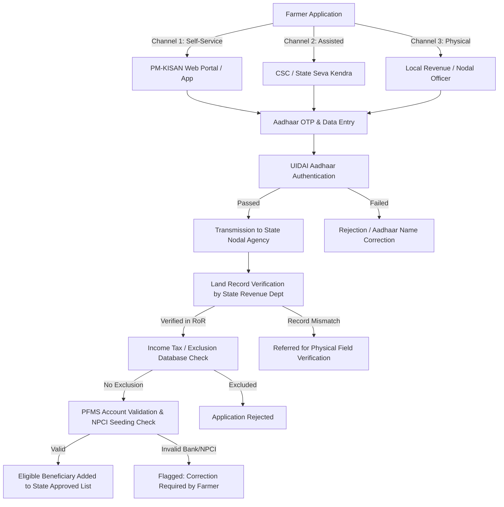

# Pradhan Mantri Kisan Samman Nidhi (PM-KISAN) - Research & Policy Documentation

> **Research Metadata**  
> - **Date of Research**: November 3, 2026  
> - **Governing Ministry**: Ministry of Agriculture & Farmers Welfare, Department of Agriculture & Farmers Welfare (DA&FW), Government of India  
> - **Official Primary Sources**:  
>   1. Official PM-KISAN Portal: [https://pmkisan.gov.in/](https://pmkisan.gov.in/)  
>   2. Revised Operational Guidelines (English): [https://pmkisan.gov.in/Documents/RevisedPM-KISANOperationalGuidelines%28English%29.pdf](https://pmkisan.gov.in/Documents/RevisedPM-KISANOperationalGuidelines%28English%29.pdf)  
>   3. PM-KISAN Frequently Asked Questions (FAQ): [https://pmkisan.gov.in/Documents/FAQPMKISAN.PDF](https://pmkisan.gov.in/Documents/FAQPMKISAN.PDF)  

---

## 1. Scheme Overview

* **Scheme Name**: Pradhan Mantri Kisan Samman Nidhi (PM-KISAN)  
  *Source*: [https://pmkisan.gov.in/Documents/RevisedPM-KISANOperationalGuidelines%28English%29.pdf](https://pmkisan.gov.in/Documents/RevisedPM-KISANOperationalGuidelines%28English%29.pdf) (Section 1.1)
* **Scheme Classification**: Central Sector Scheme with **100% financial assistance** funded directly by the Government of India.  
  *Source*: [https://pmkisan.gov.in/Documents/RevisedPM-KISANOperationalGuidelines%28English%29.pdf](https://pmkisan.gov.in/Documents/RevisedPM-KISANOperationalGuidelines%28English%29.pdf) (Section 1.1)
* **Effective Inception**: The scheme became operational on **01.12.2018**.  
  *Source*: [https://pmkisan.gov.in/Documents/RevisedPM-KISANOperationalGuidelines%28English%29.pdf](https://pmkisan.gov.in/Documents/RevisedPM-KISANOperationalGuidelines%28English%29.pdf) (Section 1.1)
* **Historical Scope Modification**:  
  At its initial launch (operational guidelines issued in December 2018), the scheme covered only Small and Marginal Farmers (SMFs) owning cultivable land up to 2 hectares. However, **with effect from 01.04.2019**, the Union Cabinet expanded the coverage to **all landholding eligible farmer families**, irrespective of the size of their landholding, subject to statutory exclusion criteria.  
  *Source*: [https://pmkisan.gov.in/Documents/RevisedPM-KISANOperationalGuidelines%28English%29.pdf](https://pmkisan.gov.in/Documents/RevisedPM-KISANOperationalGuidelines%28English%29.pdf) (Section 1.1), [https://pmkisan.gov.in/Documents/FAQPMKISAN.PDF](https://pmkisan.gov.in/Documents/FAQPMKISAN.PDF) (Question 1)

---

## 2. Scheme Objectives

1. **Supplemental Income Support**: Provide assured direct income support to all eligible landholding farmer families across the country to supplement their financial needs.  
   *Source*: [https://pmkisan.gov.in/Documents/RevisedPM-KISANOperationalGuidelines%28English%29.pdf](https://pmkisan.gov.in/Documents/RevisedPM-KISANOperationalGuidelines%28English%29.pdf) (Section 2.1)
2. **Agricultural Input Procurement**: Assist farmers in procuring essential agricultural and horticultural inputs (such as seeds, fertilizers, pesticides, and equipment) to ensure appropriate crop health and anticipated crop yields at the conclusion of each harvest cycle.  
   *Source*: [https://pmkisan.gov.in/Documents/RevisedPM-KISANOperationalGuidelines%28English%29.pdf](https://pmkisan.gov.in/Documents/RevisedPM-KISANOperationalGuidelines%28English%29.pdf) (Section 2.1)
3. **Protection from Informal Usury**: Prevent small, marginal, and agrarian families from falling into distress borrowing or into the clutches of moneylenders to meet incidental domestic and agricultural expenses.  
   *Source*: [https://pmkisan.gov.in/Documents/RevisedPM-KISANOperationalGuidelines%28English%29.pdf](https://pmkisan.gov.in/Documents/RevisedPM-KISANOperationalGuidelines%28English%29.pdf) (Section 2.1)

---

## 3. Benefits and Payment Structure

* **Financial Quantum**: ₹6,000/- (Rupees Six Thousand only) per year per eligible landholding farmer family.  
  *Source*: [https://pmkisan.gov.in/Documents/RevisedPM-KISANOperationalGuidelines%28English%29.pdf](https://pmkisan.gov.in/Documents/RevisedPM-KISANOperationalGuidelines%28English%29.pdf) (Section 3.1)
* **Installment Schedule**: Payable in **three equal four-monthly installments** of ₹2,000/- each:
  - **Period 1**: April to July
  - **Period 2**: August to November
  - **Period 3**: December to March  
  *Source*: [https://pmkisan.gov.in/Documents/RevisedPM-KISANOperationalGuidelines%28English%29.pdf](https://pmkisan.gov.in/Documents/RevisedPM-KISANOperationalGuidelines%28English%29.pdf) (Section 3.1)
* **Mode of Transfer**: Direct Benefit Transfer (DBT) directly into the verified, Aadhaar-seeded bank account of the beneficiary through the Public Financial Management System (PFMS) and the National Payments Corporation of India (NPCI) Aadhaar Payment Bridge (APB).  
  *Source*: [https://pmkisan.gov.in/Documents/RevisedPM-KISANOperationalGuidelines%28English%29.pdf](https://pmkisan.gov.in/Documents/RevisedPM-KISANOperationalGuidelines%28English%29.pdf) (Section 3.2), [https://pmkisan.gov.in/](https://pmkisan.gov.in/)

---

## 4. Official Definition of a Farmer Family

Under the official PM-KISAN Operational Guidelines, the beneficiary unit is defined strictly at the family level:

> **"A landholder farmer’s family is defined as a family comprising of husband, wife and minor children who own cultivable land as per the land records of the concerned State/UT."**  
> *Source*: [https://pmkisan.gov.in/Documents/RevisedPM-KISANOperationalGuidelines%28English%29.pdf](https://pmkisan.gov.in/Documents/RevisedPM-KISANOperationalGuidelines%28English%29.pdf) (Section 1.2), [https://pmkisan.gov.in/Documents/FAQPMKISAN.PDF](https://pmkisan.gov.in/Documents/FAQPMKISAN.PDF) (Question 4)

### Key Legal Implications:
1. **Single Benefit per Household**: Only one installment of ₹2,000 per period (₹6,000 annually) can be disbursed to a single family unit. If both husband and wife own land parcels, only one member of the family unit is eligible to receive benefits.  
   *Source*: [https://pmkisan.gov.in/Documents/FAQPMKISAN.PDF](https://pmkisan.gov.in/Documents/FAQPMKISAN.PDF) (Question 4 & 5)
2. **Adult Children (18+ Years)**: Sons and daughters who have attained the age of majority (18 years and above) and who have separate cultivable land parcels legally recorded in their own names in the State/UT revenue records are treated as separate, distinct farmer families and may apply independently if not otherwise disqualified.  
   *Source*: [https://pmkisan.gov.in/Documents/FAQPMKISAN.PDF](https://pmkisan.gov.in/Documents/FAQPMKISAN.PDF) (Question 4 & 18)
3. **Minor Children**: Children under 18 cannot claim separate benefits even if land is registered in their name; their land is pooled into the parental family unit.  
   *Source*: [https://pmkisan.gov.in/Documents/RevisedPM-KISANOperationalGuidelines%28English%29.pdf](https://pmkisan.gov.in/Documents/RevisedPM-KISANOperationalGuidelines%28English%29.pdf) (Section 1.2)

---

## 5. Eligibility Conditions

The following conditions determine whether an applicant family qualifies under the scheme:

### 5.1 Landholding Criteria
* **No Land Ceiling (Abolition of 2-Hectare Limit)**:  
  > [!IMPORTANT]  
  > The initial 2-hectare restriction was rescinded effective **01.04.2019**. There is **no upper ceiling** on landholding size for eligibility. All landholding farmer families with cultivable land are eligible, regardless of whether their holding is 0.1 hectare or 20 hectares, subject to exclusion criteria.  
  *Source*: [https://pmkisan.gov.in/Documents/RevisedPM-KISANOperationalGuidelines%28English%29.pdf](https://pmkisan.gov.in/Documents/RevisedPM-KISANOperationalGuidelines%28English%29.pdf) (Section 1.1), [https://pmkisan.gov.in/Documents/FAQPMKISAN.PDF](https://pmkisan.gov.in/Documents/FAQPMKISAN.PDF) (Question 1)
* **Cultivable Land Required**: The landholding must be officially classified as **cultivable agricultural land** according to the land revenue records of the respective State/UT. Land converted to commercial, industrial, or residential usage is ineligible.  
  *Source*: [https://pmkisan.gov.in/Documents/RevisedPM-KISANOperationalGuidelines%28English%29.pdf](https://pmkisan.gov.in/Documents/RevisedPM-KISANOperationalGuidelines%28English%29.pdf) (Section 2.2), [https://pmkisan.gov.in/Documents/FAQPMKISAN.PDF](https://pmkisan.gov.in/Documents/FAQPMKISAN.PDF) (Question 7)
* **Rural vs. Urban Cultivable Land**: Cultivable agricultural land located in urban or peri-urban municipal boundaries is eligible provided it is entered as cultivable agricultural land in revenue records and not disqualified by exclusion categories.  
  *Source*: [https://pmkisan.gov.in/Documents/FAQPMKISAN.PDF](https://pmkisan.gov.in/Documents/FAQPMKISAN.PDF) (Question 8)

### 5.2 Cut-off Date & Ownership Mutation Rules
* **Statutory Cut-off Date: 01.02.2019**:  
  The determining cut-off date for ownership of land is **February 1, 2019**. The land must have been registered in the name of the beneficiary farmer family in state land records on or before this date.  
  *Source*: [https://pmkisan.gov.in/Documents/RevisedPM-KISANOperationalGuidelines%28English%29.pdf](https://pmkisan.gov.in/Documents/RevisedPM-KISANOperationalGuidelines%28English%29.pdf) (Section 4.1)
* **Exception for Succession / Inheritance**:  
  The 01.02.2019 cut-off rule **does not bar** individuals who acquire land ownership after 01.02.2019 **on account of succession due to the death of the original landowner**. When mutation occurs due to inheritance, the legal heir becomes eligible from the date of official mutation.  
  *Source*: [https://pmkisan.gov.in/Documents/RevisedPM-KISANOperationalGuidelines%28English%29.pdf](https://pmkisan.gov.in/Documents/RevisedPM-KISANOperationalGuidelines%28English%29.pdf) (Section 4.1 & 4.2), [https://pmkisan.gov.in/Documents/FAQPMKISAN.PDF](https://pmkisan.gov.in/Documents/FAQPMKISAN.PDF) (Question 6)
* **Non-Succession Post-Cut-off Transfers**:  
  Land acquired after 01.02.2019 via sale deed, purchase, gift deed, or partition without death succession is **not eligible** for benefits under the scheme's current provisions.  
  *Source*: [https://pmkisan.gov.in/Documents/RevisedPM-KISANOperationalGuidelines%28English%29.pdf](https://pmkisan.gov.in/Documents/RevisedPM-KISANOperationalGuidelines%28English%29.pdf) (Section 4.1)

### 5.3 Joint Landholdings & Fragmentation
* **Joint Land Titles**: If multiple eligible farmer families jointly hold a land parcel, each distinct family unit whose name is reflected in the official revenue record is eligible for separate assistance.  
  *Source*: [https://pmkisan.gov.in/Documents/FAQPMKISAN.PDF](https://pmkisan.gov.in/Documents/FAQPMKISAN.PDF) (Question 13)
* **Single Family Joint Holdings**: If members of the *same* family unit (e.g., husband and wife) jointly own land, the benefit is credited to the account of the member holding the highest land quantum or the eldest member if holdings are equal.  
  *Source*: [https://pmkisan.gov.in/Documents/FAQPMKISAN.PDF](https://pmkisan.gov.in/Documents/FAQPMKISAN.PDF) (Question 13)
* **Micro/Fragmented Holdings**: Small, fragmented holdings are eligible as long as they are cultivable agricultural land registered in the revenue record.  
  *Source*: [https://pmkisan.gov.in/Documents/FAQPMKISAN.PDF](https://pmkisan.gov.in/Documents/FAQPMKISAN.PDF) (Question 7)

### 5.4 Ineligible Agrarian Classes
* **Tenant Farmers & Sharecroppers**: Persons who cultivate land as tenants, leaseholders, or sharecroppers without owning cultivable land in their own name as per official revenue records are **ineligible**.  
  *Source*: [https://pmkisan.gov.in/Documents/RevisedPM-KISANOperationalGuidelines%28English%29.pdf](https://pmkisan.gov.in/Documents/RevisedPM-KISANOperationalGuidelines%28English%29.pdf) (Section 2.2), [https://pmkisan.gov.in/Documents/FAQPMKISAN.PDF](https://pmkisan.gov.in/Documents/FAQPMKISAN.PDF) (Question 9)
* **Agricultural Laborers**: Landless agricultural laborers are **ineligible**.  
  *Source*: [https://pmkisan.gov.in/Documents/FAQPMKISAN.PDF](https://pmkisan.gov.in/Documents/FAQPMKISAN.PDF) (Question 9)
* **Community / Forest Land Rights (Forest Rights Act - FRA)**: *Needs further verification*. In certain States/UTs, pattas granted under the Forest Rights Act have special provisions under state-specific directives, but standard PM-KISAN guidelines require formal land record entry in State revenue records.  
  *Source*: [https://pmkisan.gov.in/Documents/RevisedPM-KISANOperationalGuidelines%28English%29.pdf](https://pmkisan.gov.in/Documents/RevisedPM-KISANOperationalGuidelines%28English%29.pdf) (Section 4.1)

---

## 6. Exclusion Categories

The following categories of beneficiaries of higher economic status are strictly excluded from receiving benefits under the scheme:

### 6.1 Statutory Exclusion List
1. **Institutional Landholders**: All institutional landowners (e.g., trusts, religious institutions, corporate bodies, government bodies).  
   *Source*: [https://pmkisan.gov.in/Documents/RevisedPM-KISANOperationalGuidelines%28English%29.pdf](https://pmkisan.gov.in/Documents/RevisedPM-KISANOperationalGuidelines%28English%29.pdf) (Section 2.2.a)
2. **Constitutional Post Holders**: Former and present holders of constitutional posts (e.g., President, Vice President, Governors, Chief Justices, Judges of High Courts/Supreme Court).  
   *Source*: [https://pmkisan.gov.in/Documents/RevisedPM-KISANOperationalGuidelines%28English%29.pdf](https://pmkisan.gov.in/Documents/RevisedPM-KISANOperationalGuidelines%28English%29.pdf) (Section 2.2.b.i)
3. **Public Representatives / Ministers**:
   - Former and present Ministers / Ministers of State.
   - Former and present Members of Lok Sabha / Rajya Sabha / State Legislative Assemblies / State Legislative Councils.
   - Former and present Mayors of Municipal Corporations.
   - Former and present Chairpersons of District Panchayats (Zilla Panchayats).  
   *Source*: [https://pmkisan.gov.in/Documents/RevisedPM-KISANOperationalGuidelines%28English%29.pdf](https://pmkisan.gov.in/Documents/RevisedPM-KISANOperationalGuidelines%28English%29.pdf) (Section 2.2.b.ii)
4. **Government Employees & Officers**:
   - All serving or retired officers and employees of Central/State Government Ministries, Offices, Departments, and their field units.
   - Central or State Public Sector Enterprises (PSEs) and attached offices/autonomous institutions under Government.
   - Regular employees of Local Bodies (Municipalities/Panchayats).  
   - **Specific Exception**: Multi-Tasking Staff (MTS) / Class IV / Group D employees are **not excluded** and remain eligible if other criteria are met.  
   *Source*: [https://pmkisan.gov.in/Documents/RevisedPM-KISANOperationalGuidelines%28English%29.pdf](https://pmkisan.gov.in/Documents/RevisedPM-KISANOperationalGuidelines%28English%29.pdf) (Section 2.2.b.iii)
5. **Pensioners (Monthly Pension $\ge$ ₹10,000)**: All superannuated/retired pensioners whose monthly pension is ₹10,000/- or more (excluding Multi-Tasking Staff / Class IV / Group D employees).  
   *Source*: [https://pmkisan.gov.in/Documents/RevisedPM-KISANOperationalGuidelines%28English%29.pdf](https://pmkisan.gov.in/Documents/RevisedPM-KISANOperationalGuidelines%28English%29.pdf) (Section 2.2.b.iv)
6. **Income Tax Payees**: All persons who paid Income Tax in the last assessment year.  
   *Source*: [https://pmkisan.gov.in/Documents/RevisedPM-KISANOperationalGuidelines%28English%29.pdf](https://pmkisan.gov.in/Documents/RevisedPM-KISANOperationalGuidelines%28English%29.pdf) (Section 2.2.b.v)
7. **Registered Professionals**: Professionals including Doctors, Engineers, Lawyers, Chartered Accountants (CAs), and Architects who are registered with professional bodies and carry out active professional practice.  
   *Source*: [https://pmkisan.gov.in/Documents/RevisedPM-KISANOperationalGuidelines%28English%29.pdf](https://pmkisan.gov.in/Documents/RevisedPM-KISANOperationalGuidelines%28English%29.pdf) (Section 2.2.b.vi)
8. **Non-Resident Indians (NRIs)**: Landholding farmer families who are NRIs under the provisions of the Income Tax Act, 1961.  
   *Source*: [https://pmkisan.gov.in/Documents/RevisedPM-KISANOperationalGuidelines%28English%29.pdf](https://pmkisan.gov.in/Documents/RevisedPM-KISANOperationalGuidelines%28English%29.pdf) (Section 2.2)

---

### 6.2 Confirmed Exclusions vs. Suspected Cases for Physical Verification

It is critical to distinguish between conclusive systemic disqualifications and suspected cases requiring field verification:

| Criterion Type | Category | Action / Mechanism | Source |
|---|---|---|---|
| **Confirmed Exclusion** | Income Tax Payee (Last Assessment Year) | Automated PAN-Aadhaar database integration with Central Board of Direct Taxes (CBDT). Benefit stopped immediately; recovery initiated. | [https://pmkisan.gov.in/](https://pmkisan.gov.in/) |
| **Confirmed Exclusion** | Serving / Retired Govt / PSE Officer | Systemic match with State/Central HRMS and pension databases (excluding Group D/MTS). Registration rejected. | [https://pmkisan.gov.in/Documents/RevisedPM-KISANOperationalGuidelines%28English%29.pdf](https://pmkisan.gov.in/Documents/RevisedPM-KISANOperationalGuidelines%28English%29.pdf) (Section 2.2) |
| **Confirmed Exclusion** | Institutional Landowner | Revenue title indicates trust, society, or corporate ownership. Immediate disqualification. | [https://pmkisan.gov.in/Documents/RevisedPM-KISANOperationalGuidelines%28English%29.pdf](https://pmkisan.gov.in/Documents/RevisedPM-KISANOperationalGuidelines%28English%29.pdf) (Section 2.2) |
| **Suspected Case (Pending Verification)** | Land Mutation After 01.02.2019 | Installments withheld under "Know Your Status" until field verification by Tehsildar/Patwari confirms mutation was due to death succession and not sale/gift. | [https://pmkisan.gov.in/](https://pmkisan.gov.in/), [https://pmkisan.gov.in/Documents/RevisedPM-KISANOperationalGuidelines%28English%29.pdf](https://pmkisan.gov.in/Documents/RevisedPM-KISANOperationalGuidelines%28English%29.pdf) (Section 4.1) |
| **Suspected Case (Pending Verification)** | Duplicate Household Claim / Same Ration Card | Flagged when multiple claims originate from the same family unit (e.g. husband and wife both applied). Payments held until verification confirms single eligible recipient. | [https://pmkisan.gov.in/](https://pmkisan.gov.in/) |
| **Suspected Case (Pending Verification)** | Land Record / Name Discrepancy | Mismatch between applicant name in Aadhaar and owner name in digitised Record of Rights (RoR). Referred to Patwari/Tehsildar for physical verification. | [https://pmkisan.gov.in/Documents/RevisedPM-KISANOperationalGuidelines%28English%29.pdf](https://pmkisan.gov.in/Documents/RevisedPM-KISANOperationalGuidelines%28English%29.pdf) (Section 4.3) |
| **Mandatory Annual Audit** | Random 5% Physical Verification | Mandatory 5% sample of total beneficiaries selected randomly by the system every year for on-ground physical verification by District Collectors. | [https://pmkisan.gov.in/Documents/RevisedPM-KISANOperationalGuidelines%28English%29.pdf](https://pmkisan.gov.in/Documents/RevisedPM-KISANOperationalGuidelines%28English%29.pdf) (Section 5) |

---

## 7. Required Registration Information and Documents

### 7.1 Distinguishing Eligibility Criteria vs. Registration / Verification Requirements
- **Eligibility Conditions**: The legal prerequisites defined by law (owning cultivable land on or before 01.02.2019 or succession, and non-applicability of exclusions).
- **Registration Requirements**: The data points and identity attributes needed to enroll an applicant into the PM-KISAN database.
- **Verification Requirements**: Multi-agency checks (UIDAI, PFMS/NPCI, State Land Revenue records) to validate that submitted registration data represents true legal entitlements.

### 7.2 Mandatory Data Fields for Registration
1. **Full Name**: As printed on the Aadhaar Card.  
   *Source*: [https://pmkisan.gov.in/Documents/RevisedPM-KISANOperationalGuidelines%28English%29.pdf](https://pmkisan.gov.in/Documents/RevisedPM-KISANOperationalGuidelines%28English%29.pdf) (Section 4.3)
2. **Gender & Social Category**: Male / Female / Other; General / OBC / SC / ST.  
   *Source*: [https://pmkisan.gov.in/Documents/RevisedPM-KISANOperationalGuidelines%28English%29.pdf](https://pmkisan.gov.in/Documents/RevisedPM-KISANOperationalGuidelines%28English%29.pdf) (Annexure-I)
3. **Aadhaar Number**: 12-digit UID.  
   *Source*: [https://pmkisan.gov.in/Documents/RevisedPM-KISANOperationalGuidelines%28English%29.pdf](https://pmkisan.gov.in/Documents/RevisedPM-KISANOperationalGuidelines%28English%29.pdf) (Section 4.3)
4. **Mobile Number**: Active mobile number (mandatory for SMS notifications and OTP authentication).  
   *Source*: [https://pmkisan.gov.in/](https://pmkisan.gov.in/)
5. **Ration Card Number**: Compulsory in modern portal registration for household deduplication.  
   *Source*: [https://pmkisan.gov.in/](https://pmkisan.gov.in/)
6. **Land Details**:
   - State, District, Sub-District / Tehsil, Block, Village.
   - Land Survey / Khasra / Dag / Gut Number.
   - Khata / Khatauni Number.
   - Area of Land (in hectares).
   - Date of Land Transfer and whether transfer occurred before or after 01.02.2019.
   - Land transfer reason (Ancestor death, Purchase, Gift, etc.).  
   *Source*: [https://pmkisan.gov.in/](https://pmkisan.gov.in/), [https://pmkisan.gov.in/Documents/RevisedPM-KISANOperationalGuidelines%28English%29.pdf](https://pmkisan.gov.in/Documents/RevisedPM-KISANOperationalGuidelines%28English%29.pdf) (Annexure-I)
7. **Bank Account Details**:
   - Bank Account Number.
   - IFSC Code.
   - Account must be actively **Aadhaar-seeded** and mapped to the NPCI DBT mapper.  
   *Source*: [https://pmkisan.gov.in/](https://pmkisan.gov.in/), [https://pmkisan.gov.in/Documents/FAQPMKISAN.PDF](https://pmkisan.gov.in/Documents/FAQPMKISAN.PDF) (Question 2 & 14)
8. **Self-Declaration Undertaking**: Formal electronic check confirming non-exclusion under Section 2.2.  
   *Source*: [https://pmkisan.gov.in/Documents/RevisedPM-KISANOperationalGuidelines%28English%29.pdf](https://pmkisan.gov.in/Documents/RevisedPM-KISANOperationalGuidelines%28English%29.pdf) (Annexure-I)

### 7.3 Supporting Documents Required
* **Aadhaar Card**: Scanned copy / physical card for eKYC.  
  *Source*: [https://pmkisan.gov.in/](https://pmkisan.gov.in/)
* **Land Ownership Document (Record of Rights / 7/12 / Khatauni)**: PDF upload (max 200 KB on the web portal).  
  *Source*: [https://pmkisan.gov.in/](https://pmkisan.gov.in/)
* **Bank Passbook / Cancelled Cheque**: Scanned document (used for manual verification if Aadhaar-bank account mapping fails).  
  *Source*: [https://pmkisan.gov.in/Documents/FAQPMKISAN.PDF](https://pmkisan.gov.in/Documents/FAQPMKISAN.PDF) (Question 14)

### 7.4 Important Caveat: Land Record Upload vs. Legal Ownership
> [!WARNING]  
> **Uploading a land record extract (such as a 7/12, Khasra, or RoR PDF) during registration DOES NOT constitute proof of legal ownership.**  
> Under PM-KISAN guidelines, self-uploaded land documents serve solely as an application submission. Legal ownership and cultivable status are determined **exclusively** when the relevant State Revenue Department (Tehsildar, Revenue Inspector, or Patwari) matches and verifies the record against the official digitized State Land Database. If the document is outdated, forged, or unverified in the State revenue repository, the registration is rejected.  
> *Source*: [https://pmkisan.gov.in/Documents/RevisedPM-KISANOperationalGuidelines%28English%29.pdf](https://pmkisan.gov.in/Documents/RevisedPM-KISANOperationalGuidelines%28English%29.pdf) (Section 4.1 & 4.3)

---

## 8. eKYC Requirements

To prevent fraudulent claims and ensure that disbursements reach authentic, living beneficiaries, **eKYC is mandatory** for all farmers registered under PM-KISAN.  
*Source*: [https://pmkisan.gov.in/](https://pmkisan.gov.in/)

### 8.1 Official Modes of eKYC
1. **OTP-based eKYC (Free on PM-KISAN Portal & App)**:
   - Farmer visits `https://pmkisan.gov.in/` and selects "eKYC".
   - Enters 12-digit Aadhaar Number.
   - An OTP is generated and sent to the mobile number linked with the Aadhaar card.
   - Upon successful OTP submission, eKYC status is marked complete in the central database.  
   *Source*: [https://pmkisan.gov.in/](https://pmkisan.gov.in/)
2. **Biometric-based eKYC (At CSCs / SSKs)**:
   - For farmers whose mobile numbers are not linked to Aadhaar or where OTP fails.
   - Available at Village-level Common Service Centres (CSCs) and State Seva Kendras (SSKs).
   - Identity is verified via biometric fingerprint or iris scan against UIDAI central servers.
   - Fixed nominal service charge payable to the CSC operator.  
   *Source*: [https://pmkisan.gov.in/](https://pmkisan.gov.in/)
3. **Face Authentication-based eKYC (Via PM-KISAN Mobile App)**:
   - Launched by the Ministry using UIDAI’s **Aadhaar FaceRD** mobile service.
   - Allows farmers to complete eKYC directly by scanning their face using a smartphone camera.
   - Supports assisted mode (Kisan Mitras, Agriculture Officers, or family members can scan the farmer's face on their device).  
   *Source*: [https://pmkisan.gov.in/](https://pmkisan.gov.in/)

### 8.2 Aadhaar-Bank Account Seeding (NPCI Mapping)
- Completing eKYC alone is **not sufficient** for installment disbursement.
- The beneficiary’s bank account must be actively linked to Aadhaar and seeded with the **National Payments Corporation of India (NPCI) mapper** for DBT.
- If a farmer changes bank accounts or if the bank de-links Aadhaar, payments will fail with error code *"Aadhaar not seeded with bank account"*, even if eKYC shows "Completed" on the portal.  
*Source*: [https://pmkisan.gov.in/](https://pmkisan.gov.in/), [https://pmkisan.gov.in/Documents/FAQPMKISAN.PDF](https://pmkisan.gov.in/Documents/FAQPMKISAN.PDF) (Question 2 & 14)

---

## 9. Application and Registration Process

The PM-KISAN operational framework allows both digital self-service and assisted institutional channels:



### 9.1 Step-by-Step Self-Registration Walkthrough
1. **Access Portal**: Visit the official website (`https://pmkisan.gov.in/`) and click on **New Farmer Registration** under the *Farmers Corner*.
2. **Select Category**: Choose between **Rural Farmer Registration** or **Urban Farmer Registration**.
3. **Identity Verification**: Enter Aadhaar Number, active Mobile Number, and select the domicile State. An OTP is sent to the mobile number to initiate the application.
4. **Enter Demographic Details**: Select District, Sub-District (Tehsil), Block, and Village. Name and gender are populated from UIDAI Aadhaar data.
5. **Ration Card & Family Details**: Enter the mandatory Ration Card number and date of birth.
6. **Land Details Entry**:
   - Select ownership: *Single* or *Joint*.
   - Enter Khata Number, Khasra Number, and Land Area in hectares.
   - Enter Land Transfer Status: *Before 01-02-2019* or *After 01-02-2019*.
   - Select Land Transfer Details: *Death of Husband/Father, Ancestral Land, Purchase, Gift, etc.*
7. **Document Upload**: Upload the Record of Rights (RoR) / 7/12 extract in PDF format ($\le 200\text{ KB}$).
8. **Self-Declaration & Submission**: Check the self-declaration box affirming that the applicant does not violate any exclusion criteria and submit. A unique Registration Application Reference Number is generated.  
*Source*: [https://pmkisan.gov.in/](https://pmkisan.gov.in/), [https://pmkisan.gov.in/Documents/RevisedPM-KISANOperationalGuidelines%28English%29.pdf](https://pmkisan.gov.in/Documents/RevisedPM-KISANOperationalGuidelines%28English%29.pdf) (Section 4)

---

## 10. Official Application Portal

* **Official Website**: [https://pmkisan.gov.in/](https://pmkisan.gov.in/)
* **Official Mobile Application**: **PM-KISAN Mobile App** (developed by the National Informatics Centre - NIC, Ministry of Electronics & Information Technology, Government of India).
* **Key Self-Service Tools in "Farmers Corner"**:
  - `New Farmer Registration`: Direct enrollment for rural and urban farmers.
  - `eKYC`: OTP-based Aadhaar electronic Know-Your-Customer service.
  - `Know Your Status (KYS)`: Check real-time installment release, Aadhaar seeding, and land record verification status.
  - `Status of Self Registered Farmer/CSC Farmers`: Real-time tracking of pending or rejected self-registration applications.
  - `Updation of Self Registered Farmers`: Edit and re-upload land documents or correct demographic errors flagged by authorities.
  - `Name Correction as per Aadhaar`: Resolve spelling discrepancies between registered names and UIDAI database records.
  - `Voluntary Surrender of PM-KISAN Benefits`: Facility for ineligible or economically well-off farmers to surrender benefits voluntarily.
* **National Helpdesk**:
  - PM-KISAN Toll-Free Helpline: `155261` / `1800 115 526`
  - Landline Desk: `011-23381092`, `011-23382401`
  - Email: `pmkisan-ict@gov.in`  
  *Source*: [https://pmkisan.gov.in/](https://pmkisan.gov.in/)

---

## 11. Important Verification Requirements

To maintain scheme integrity and legal compliance, verification is performed across multiple distinct regulatory layers:

```
[Level 1: UIDAI]           --> Identity & Demographic Matching
[Level 2: State Revenue]   --> Land Title, Cultivable Status & Cut-off Date (01.02.2019)
[Level 3: Central Systems] --> CBDT Income Tax & Pensioners / Govt Employee Exclusions
[Level 4: PFMS / NPCI]     --> Bank Account Seeding & DBT Bridge Verification
[Level 5: District Admin]  --> 5% Mandatory Annual Physical Verification Audit
```

### 11.1 Layered Verification Details
1. **Aadhaar Demographic Authentication**:
   - The applicant's name, gender, Aadhaar number, and date of birth are validated directly against UIDAI servers.
   - Any typographic mismatch results in rejection until corrected via the "Name Correction" portal tool.  
   *Source*: [https://pmkisan.gov.in/Documents/RevisedPM-KISANOperationalGuidelines%28English%29.pdf](https://pmkisan.gov.in/Documents/RevisedPM-KISANOperationalGuidelines%28English%29.pdf) (Section 4.3)
2. **State Land Revenue Database Verification**:
   - Responsibility for identifying and validating eligible landholding families rests **entirely with the concerned State/UT Government**.
   - State revenue officials (Patwari, Talathi, Lekhpal, Tehsildar) match the applicant’s Khasra/Khata numbers with the state’s digitized Record of Rights (Bhulekh / Mahabhulekh / Dharani, etc.).
   - The department verifies that the land is cultivable and that ownership was established on or before 01.02.2019 (or via legal inheritance).  
   *Source*: [https://pmkisan.gov.in/Documents/RevisedPM-KISANOperationalGuidelines%28English%29.pdf](https://pmkisan.gov.in/Documents/RevisedPM-KISANOperationalGuidelines%28English%29.pdf) (Section 4.1), [https://pmkisan.gov.in/Documents/FAQPMKISAN.PDF](https://pmkisan.gov.in/Documents/FAQPMKISAN.PDF) (Question 10)
3. **Income Tax & Institutional Exclusion Matching**:
   - Registered Aadhaar/PAN records are electronically cross-referenced against CBDT records to identify income tax payees in the previous assessment year.
   - Civil service and public sector pensioner databases are matched to disqualify ineligible officers and high-pension retirees ($\ge ₹10,000/\text{month}$).  
   *Source*: [https://pmkisan.gov.in/Documents/RevisedPM-KISANOperationalGuidelines%28English%29.pdf](https://pmkisan.gov.in/Documents/RevisedPM-KISANOperationalGuidelines%28English%29.pdf) (Section 2.2)
4. **Bank Account Validation & NPCI Seeding Verification**:
   - Managed via the Public Financial Management System (PFMS).
   - Validates that the beneficiary's bank account is active and mapped to the NPCI Aadhaar Payment Bridge.  
   *Source*: [https://pmkisan.gov.in/Documents/RevisedPM-KISANOperationalGuidelines%28English%29.pdf](https://pmkisan.gov.in/Documents/RevisedPM-KISANOperationalGuidelines%28English%29.pdf) (Section 3.2), [https://pmkisan.gov.in/](https://pmkisan.gov.in/)
5. **Mandatory 5% Annual Physical Verification**:
   - As mandated under **Section 5 of the Revised Operational Guidelines**, State/UT Governments must conduct on-site physical verification of at least **5% of the total beneficiaries** every year.
   - Beneficiaries are selected automatically and randomly by the PM-KISAN portal system.
   - District Collectors / District Level Committees are responsible for executing and reporting the physical verification outcomes.  
   *Source*: [https://pmkisan.gov.in/Documents/RevisedPM-KISANOperationalGuidelines%28English%29.pdf](https://pmkisan.gov.in/Documents/RevisedPM-KISANOperationalGuidelines%28English%29.pdf) (Section 5)
6. **Recovery & Legal Penalties for Ineligible Beneficiaries**:
   - If an ineligible person receives PM-KISAN funds (e.g. through concealed income tax status or multiple family claims), the State Government is empowered to initiate recovery proceedings through land revenue recovery notices.
   - Ineligible recipients are removed from the active beneficiary database.  
   *Source*: [https://pmkisan.gov.in/Documents/RevisedPM-KISANOperationalGuidelines%28English%29.pdf](https://pmkisan.gov.in/Documents/RevisedPM-KISANOperationalGuidelines%28English%29.pdf) (Section 2.2 & 6), [https://pmkisan.gov.in/Documents/FAQPMKISAN.PDF](https://pmkisan.gov.in/Documents/FAQPMKISAN.PDF) (Question 5)

---

## 12. Source URLs and Date of Research

### Official Citations
* **Central PM-KISAN Portal**: [https://pmkisan.gov.in/](https://pmkisan.gov.in/)  
  *Access Date: November 3, 2026*
* **Revised Operational Guidelines of Pradhan Mantri Kisan Samman Nidhi (English)**:  
  [https://pmkisan.gov.in/Documents/RevisedPM-KISANOperationalGuidelines%28English%29.pdf](https://pmkisan.gov.in/Documents/RevisedPM-KISANOperationalGuidelines%28English%29.pdf)  
  *Access Date: November 3, 2026*
* **Frequently Asked Questions (FAQs) on PM-KISAN Scheme**:  
  [https://pmkisan.gov.in/Documents/FAQPMKISAN.PDF](https://pmkisan.gov.in/Documents/FAQPMKISAN.PDF)  
  *Access Date: November 3, 2026*

> [!NOTE]  
> All factual statements, threshold specifications, exclusion lists, and verification directives in this document are derived directly from the official Government of India publications cited above.
